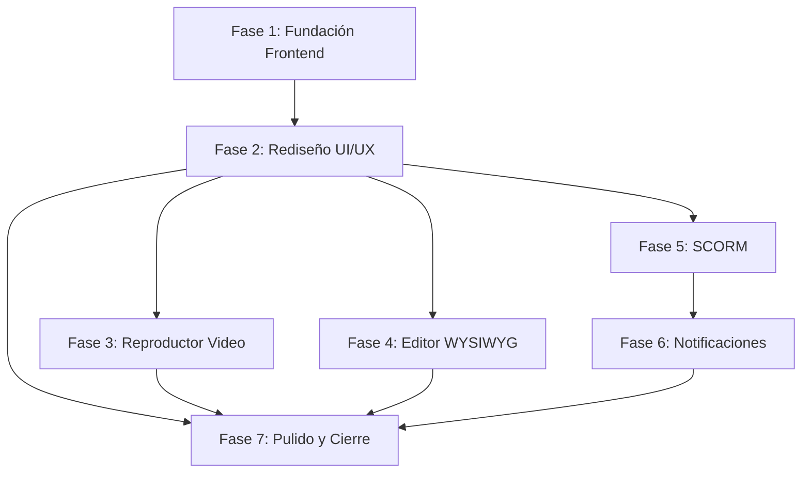

# INFORME DE AUDITORÍA — LMS LegalTech

**Archivo**: `auditoria.md`  
**Versión**: 1.0  
**Fecha**: 2026-07-XX  
**Auditor**: Agente Auditor Senior  
**Destinatario**: ROO IA (Agente Implementador)  
**Instrucción**: A petición del dueño del proyecto, se encomienda a ROO IA la tarea de completar y mejorar el sistema LMS LegalTech basándose en este informe.

---

## 1. CONTEXTO DEL PROYECTO

### 1.1 Estado Actual

Se realizó una auditoría exhaustiva del proyecto `001-lms-core`. El sistema fue migrado de Python/FastAPI a Java/Spring Boot 3.3. El código base contiene:

| Componente | Cantidad |
|------------|:--------:|
| Archivos Java (backend) | 72 clases |
| Templates Thymeleaf (frontend) | 16 páginas |
| Archivos CSS | 4 hojas |
| Archivos de test | 14 archivos |
| Migraciones Flyway | 3 archivos SQL |

### 1.2 Stack Tecnológico Actual

```
Java 17+ | Spring Boot 3.3 | PostgreSQL 16 | Redis 7 | MinIO | 
Spring Security + JJWT | Thymeleaf + HTMX | Apache POI | 
JUnit 5 + Mockito | Flyway | OpenTelemetry
```

### 1.3 Resultado de la Auditoría

| Módulo | Estado | Observación |
|--------|:------:|-------------|
| Autenticación JWT (access + refresh + MFA token) | ✅ Completo | Incluye `generateMfaToken()` para flujo TOTP |
| MFA TOTP con Google Authenticator | ✅ Completo | Servicio `MfaService` con QR URL |
| Firma Electrónica (hash encadenado) | ✅ Completo | IP extraída del servidor (X-Forwarded-For) |
| Exportaciones asíncronas (Redis pub/sub) | ✅ Completo | Worker `@Async` + `RedisMessageListenerContainer` |
| OpenTelemetry + índices BD | ✅ Completo | Migración V3 con JSONB + GIN |
| Tests unitarios y de integración | ✅ Completo | 14 archivos de test |
| Editor WYSIWYG con Quill.js | ✅ Completo | Backend listo + template `editor.html` con Quill.js v1.3.7 |
| **SCORM (paquetes e-learning)** | ✅ **Completo** | Modelo `PaqueteScorm`, servicio `ScormService`, Runtime API REST, reproductor iframe, upload drag & drop |
| **Reproductor multimedia (videos)** | ✅ **Completo** | Template `reproductor.html` con soporte de URL incrustada |
| **Notificaciones automáticas** | ✅ **Completo** | Servicio `NotificacionService` con `@Scheduled`, dropdown en header, página `/dashboard/notificaciones` |
| **Actualizar specs (documentación)** | ✅ **Completo** | `tasks.md` reestructurado a 12 fases, `clarificaciones.md` con ADR-011/ADR-012, ruta SCORM en `HomeController` |

---

## 2. REQUERIMIENTOS DEL DUEÑO DEL PROYECTO

A petición del dueño del proyecto, se solicita a ROO IA implementar lo siguiente:

### 2.1 Funcionalidades FALTANTES (Prioridad Alta)

1. **Soporte SCORM** — Subir, almacenar y reproducir paquetes SCORM 1.2/2004
2. **Reproductor de video** — Reproductor de video incrustado en cursos
3. **Editor WYSIWYG** — Editor visual para contenido de cursos y evaluaciones

### 2.2 Mejora UI/UX (Prioridad Alta)

Se solicita un **rediseño completo de la interfaz** con estilo **SaaS premium moderno**:

- **Paleta de colores**: Coherente, profesional, con primary, secondary, accent bien definidos
- **Tipografía**: Sans-serif legible (Inter, system fonts)
- **Espacio en blanco**: Generoso,呼吸able
- **Sombras suaves (soft shadows)**: Para profundidad sin agresividad
- **Componentes consistentes**: Botones, cards, tablas, formularios, badges
- **Micro-interacciones**: Hover states suaves, transiciones, loading states
- **Responsive**: Desktop-first con adaptación mobile
- **Modo oscuro (dark mode)**: Como plus opcional

### 2.3 Estilo Visual Objetivo

Diseñar una interfaz similar a:
- **Linear.app** — Limpio, minimalista, con mucho espacio blanco
- **Notion** — Tipografía clara, componentes simples
- **Stripe** — Gradientes sutiles, cards con sombras suaves
- **Vercel** — Oscuro claro, tipografía bold, bordes redondeados

---

## 3. PLAN DE TRABAJO PARA ROO IA

### ⚠️ REGLAS IMPORTANTES

1. **Solo javascript vainilla** — No usar React, Vue, Alpine.js, Stimulus ni ningún framework JS. Usar solo HTMX + JavaScript vanilla.
2. **CSS puro** — No usar Tailwind, Bootstrap ni ningún framework CSS. Usar el sistema de archivos CSS existente (`variables.css`, `base.css`, `components.css`, `layout.css`).
3. **100% español** — Código, comentarios, logs, UI, todo en español.
4. **No modificar nada del backend** — Salvo que se indique explícitamente. Trabajar solo en frontend (templates Thymeleaf + CSS).
5. **No romper tests existentes** — Los 14 archivos de test deben seguir pasando.
6. **Commit granular** — Un commit por cada fase completada.

---

### 🔷 FASE 1: FUNDACIÓN — Preparación del Frontend

**Objetivo**: Preparar la base del frontend para recibir las nuevas funcionalidades.

**Tiempo estimado**: 1 sesión

**Tareas**:

- [x] **T1.1** — Revisar `src/main/resources/static/css/variables.css` y actualizar paleta de colores a tonos más modernos (ej: azul slate o índigo en lugar de azul marino oscuro). Mantener el dorado como accent pero más sutil.
- [x] **T1.2** — Revisar `src/main/resources/static/css/components.css` y mejorar: sombras suaves, bordes redondeados más pronunciados, transiciones suaves en todos los componentes.
- [x] **T1.3** — Revisar `src/main/resources/static/css/layout.css` y mejorar: sidebar más moderna, header más limpio, responsive mejorado.
- [x] **T1.4** — Agregar animaciones de entrada (`animate-fade-in`, `animate-slide-up`, `animate-scale-in`) en `components.css`.
- [x] **T1.5** — Agregar soporte para dark mode (variables `[data-theme="dark"]`) en `variables.css`.
- [x] **T1.6** — Crear `src/main/resources/static/js/app.js` con funciones utilitarias globales (formateo de fechas, manejo de errores, notificaciones toast).
- [x] **T1.7** — Actualizar `fragments/head.html` para cargar `app.js` y Google Fonts (Inter).

---

### 🔷 FASE 2: REDISEÑO UI/UX — Templates Existentes

**Objetivo**: Modernizar TODOS los templates Thymeleaf existentes con el nuevo diseño.

**Tiempo estimado**: 2-3 sesiones

**Tareas por template** (aplicar el mismo estilo moderno a todos):

- [x] **T2.1** — `fragments/header.html` — Rediseñar: navbar minimalista, logo + navegación limpia, menú de usuario con avatar, dropdown, indicador de sistema operativo (dot verde).
- [x] **T2.2** — `fragments/footer.html` — Footer simple con links y copyright.
- [x] **T2.3** — `fragments/head.html` — Meta tags, Google Fonts, CSS, JS.
- [x] **T2.4** — `index.html` (home) — Hero section moderno con gradiente, CTA buttons, features grid con iconos SVG, sección de beneficios, footer.
- [x] **T2.5** — `auth/login.html` — Formulario centrado, card flotante con sombra, input con íconos, botón primary, link a registro, validación visual.
- [x] **T2.6** — `auth/registro.html` — Similar a login con más campos, selector de idioma.
- [x] **T2.7** — `auth/consentimiento.html` — Documento legal renderizado bonito, checkbox estilizado, botones aceptar/rechazar con confirmación.
- [x] **T2.8** — `dashboard/index.html` — KPIs en cards con íconos, gráfica de actividad reciente (placeholder), accesos directos, sidebar con navegación.
- [x] **T2.9** — `dashboard/documentos.html` — Zona de drag & drop mejorada, tabla de documentos con acciones, modal de confirmación para eliminar.
- [x] **T2.10** — `dashboard/firmas.html** — Lista de documentos pendientes de firma, botón firmar con confirmación, historial de firmas.
- [x] **T2.11** — `dashboard/exportaciones.html` — Botón solicitar exportación, tabla de exportaciones con estado (badge), botón descargar.
- [x] **T2.12** — `dashboard/perfil.html` — Foto/avatar, datos personales, configuración MFA (botón activar con QR modal), cambio contraseña, consentimiento.
- [x] **T2.13** — `cursos/listado.html` — Grid de tarjetas de curso, cada una con: portada (placeholder), título, progreso (barra), categoría (badge), instructor, fecha.
- [x] **T2.14** — `admin/usuarios.html` — Tabla de usuarios con filtros, búsqueda, acciones por fila (editar, desactivar, roles), modal de creación/edición.
- [x] **T2.15** — `admin/roles.html` — Lista de roles con permisos asignados (checkboxes), tabla de permisos, modal de creación.
- [x] **T2.16** — `admin/auditoria.html` — Tabla de eventos con filtros por tipo/fecha, detalle expandible, verificación de cadena de hash.

**Criterios de diseño para cada template**:
- Cards con `border-radius: 12px`, `box-shadow` suave, hover con `translateY(-2px)`
- Botones con gradientes sutiles, border-radius: 8px, padding cómodo
- Tablas con header oscuro, filas con hover, responsive scroll
- Formularios con input estilizado, focus ring sutil, labels flotantes
- Badges con border-radius pill, colores semánticos
- Sidebar con íconos SVG, active state con color de fondo
- Loading states con skeleton screens o spinners animados

---

### 🔷 FASE 3: REPRODUCTOR MULTIMEDIA (VIDEOS)

**Objetivo**: Agregar reproductor de video en cursos y documentos multimedia.

**Tiempo estimado**: 1 sesión

**Tareas**:

- [x] **T3.1** — Crear `dashboard/reproductor.html` — Template para visualizar video dentro de un curso.
- [x] **T3.2** — Crear `CursoController.java` — Endpoint `GET /api/v1/cursos/{id}/reproductor` que sirva el template con los datos del video.
- [x] **T3.3** — En `DocumentoController.java` — Endpoint `GET /api/v1/documentos/{id}/stream` para servido progresivo de video (range requests).
- [x] **T3.4** — En `documentos.html` — Al hacer click en un archivo de video, abrir el reproductor en un modal o nueva página.
- [x] **T3.5** — En `listado.html` (cursos) — Si el curso tiene contenido multimedia, mostrar un badge "🎬 Multimedia" y enlace al reproductor.

---

### 🔷 FASE 4: EDITOR WYSIWYG

**Objetivo**: Integrar editor visual para contenido de cursos y evaluaciones.

**Tiempo estimado**: 1-2 sesiones

**Tareas**:

- [x] **T4.1** — Elegir editor WYSIWYG liviano y sin dependencias JS pesadas. **→ Se usó Quill.js**, incluido localmente en `src/main/resources/static/js/quill/`.
- [x] **T4.2** — Crear `src/main/resources/static/js/quill/config.js` — Configuración del editor Quill con toolbar personalizado.
- [x] **T4.3** — Crear `src/main/resources/static/css/quill-custom.css` — Sobrescribir estilos de Quill para que coincidan con el tema del LMS.
- [x] **T4.4** — Crear `cursos/editor.html` — Template para crear/editar curso con editor WYSIWYG.
- [x] **T4.5** — Crear `evaluaciones/editor.html` — Template para crear/editar evaluación con editor WYSIWYG.
- [x] **T4.6** — En `evaluaciones/listado.html` — Mostrar evaluaciones con contenido renderizado (no HTML crudo).

---

### 🔷 FASE 5: SOPORTE SCORM

**Objetivo**: Implementar subida, almacenamiento y reproducción de paquetes SCORM 1.2 y 2004.

**Tiempo estimado**: 2-3 sesiones

**Tareas**:

#### 5.1 — Modelo de Datos

- [x] **T5.1.1** — Crear migración Flyway `V4__create_scorm_tables.sql` con:

```sql
CREATE TABLE paquetes_scorm (
    id UUID PRIMARY KEY DEFAULT gen_random_uuid(),
    curso_id UUID NOT NULL REFERENCES cursos(id),
    titulo VARCHAR(255) NOT NULL,
    descripcion TEXT,
    version_scorm VARCHAR(10) NOT NULL,  -- '1.2' o '2004'
    url_zip VARCHAR(512) NOT NULL,       -- URL en MinIO del ZIP original
    url_index VARCHAR(512) NOT NULL,     -- URL del index.html extraído
    hash_sha256 VARCHAR(64) NOT NULL,
    tamano_bytes BIGINT NOT NULL,
    created_at TIMESTAMP NOT NULL DEFAULT NOW(),
    deleted_at TIMESTAMP,
    deleted_by UUID REFERENCES usuarios(id),
    reason TEXT
);

CREATE TABLE scorm_datos_alumno (
    id UUID PRIMARY KEY DEFAULT gen_random_uuid(),
    paquete_id UUID NOT NULL REFERENCES paquetes_scorm(id),
    usuario_id UUID NOT NULL REFERENCES usuarios(id),
    intento_id UUID NOT NULL,
    clave VARCHAR(255) NOT NULL,          -- Ej: 'cmi.core.score.raw'
    valor TEXT NOT NULL,
    created_at TIMESTAMP NOT NULL DEFAULT NOW(),
    UNIQUE(paquete_id, usuario_id, intento_id, clave)
);

CREATE INDEX idx_scorm_paquete_curso ON paquetes_scorm(curso_id);
CREATE INDEX idx_scorm_datos_paquete ON scorm_datos_alumno(paquete_id);
CREATE INDEX idx_scorm_datos_usuario ON scorm_datos_alumno(usuario_id);
```

#### 5.2 — Entidad Java

- [x] **T5.2.1** — Crear `model/PaqueteScorm.java` — Entidad JPA mapeando `paquetes_scorm`.
- [x] **T5.2.2** — Crear `model/ScormDatoAlumno.java` — Entidad JPA mapeando `scorm_datos_alumno`.

#### 5.3 — Repositorios

- [x] **T5.3.1** — Crear `repository/PaqueteScormRepository.java`
- [x] **T5.3.2** — Crear `repository/ScormDatoAlumnoRepository.java`

#### 5.4 — Servicio SCORM

- [x] **T5.4.1** — Crear `service/ScormService.java` con métodos:
  - `subirPaqueteScorm(MultipartFile zip, UUID cursoId, UUID usuarioId)`:
    1. Validar que el ZIP contiene `imsmanifest.xml`
    2. Extraer el ZIP a una carpeta temporal
    3. Parsear `imsmanifest.xml` para obtener: título, versión SCORM, recursos, organizaciones
    4. Subir archivos extraídos a MinIO
    5. Registrar `PaqueteScorm` en BD
    6. Registrar evento de auditoría
  - `obtenerManifiesto(UUID paqueteId)`: Devolver datos del `imsmanifest.xml`
  - `registrarDatoAlumno(UUID paqueteId, UUID usuarioId, String clave, String valor)`: Guardar datos de progreso
  - `obtenerDatosAlumno(UUID paqueteId, UUID usuarioId)`: Recuperar progreso del alumno

#### 5.5 — API Runtime SCORM

- [x] **T5.5.1** — Crear `service/ScormRuntimeService.java` que implemente la API Runtime de SCORM:
  - `LMSInitialize(paqueteId, usuarioId)` → Inicializar sesión, devolver `"true"`
  - `LMSFinish(paqueteId, usuarioId)` → Cerrar sesión, devolver `"true"`
  - `LMSGetValue(paqueteId, usuarioId, clave)` → Obtener valor almacenado
  - `LMSSetValue(paqueteId, usuarioId, clave, valor)` → Almacenar valor
  - `LMSCommit(paqueteId, usuarioId)` → Commit (persistir valores)
  - `LMSGetLastError()` → Obtener último error
  - `LMSGetErrorString(errorCode)` → Obtener mensaje de error
  - `LMSGetDiagnostic(errorCode)` → Obtener diagnóstico

- [x] **T5.5.2** — Implementar API REST para runtime SCORM (endpoints en `ScormController.java`):
  ```java
  POST /api/v1/scorm/{paqueteId}/initialize   → { "result": "true" }
  POST /api/v1/scorm/{paqueteId}/setValue      → { "clave": "...", "valor": "...", "result": "true" }
  GET  /api/v1/scorm/{paqueteId}/getValue?clave=... → { "valor": "..." }
  POST /api/v1/scorm/{paqueteId}/commit        → { "result": "true" }
  POST /api/v1/scorm/{paqueteId}/finish        → { "result": "true" }
  ```

#### 5.6 — Controlador y Frontend

- [x] **T5.6.1** — Crear `controller/ScormController.java` con endpoints:
  - `POST /api/v1/cursos/{cursoId}/scorm/upload` — Subir paquete SCORM
  - `GET /api/v1/cursos/{cursoId}/scorm` — Listar paquetes SCORM del curso
  - `DELETE /api/v1/scorm/{paqueteId}` — Eliminar paquete
  - `GET /api/v1/scorm/{paqueteId}/play` — Cargar reproductor SCORM (template Thymeleaf)

- [x] **T5.6.2** — Crear `cursos/scorm-upload.html` — Formulario de subida con:
  - Drag & drop para archivo ZIP
  - Validación de que es un ZIP válido
  - Barra de progreso de subida
  - Confirmación con metadatos extraídos (título, versión SCORM)

- [x] **T5.6.3** — Crear `cursos/scorm-player.html` — Reproductor SCORM con:
  - Iframe que carga el `index.html` del paquete desde MinIO
  - JavaScript embebido que intercepta la API SCORM del iframe
  - Comunicación con el backend via fetch a los endpoints REST
  - Barra de progreso del alumno
  - Botón de cerrar/volver al curso

- [x] **T5.6.4** — Actualizar `cursos/listado.html`:
  - Si el curso tiene SCORM, mostrar badge "📦 SCORM"
  - Botón "Reproducir" que abre el player

- [x] **T5.6.5** — Agregar en `header.html` enlace a "Biblioteca SCORM" si hay contenido SCORM disponible. **(COMPLETADO ✅ — Enlace "Biblioteca SCORM" agregado en dropdown de usuario y menú móvil, ruta `/cursos/scorm` en HomeController)**

#### 5.7 — API de Comunicación SCORM (JS)

- [x] **T5.7.1** — Crear `src/main/resources/static/js/scorm-api.js` — Implementación del lado del cliente que:
  - Se inyecta en el iframe del paquete SCORM
  - Implementa `API_1484_11` (SCORM 2004) o `API` (SCORM 1.2)
  - Traduce llamadas JS a fetch contra el backend
  - Maneja timeouts y errores de conexión

---

### 🔷 FASE 6: NOTIFICACIONES AUTOMÁTICAS (Fase 2)

**Objetivo**: Sistema de notificaciones automáticas por email para vencimientos, reprobación, etc.

**Tiempo estimado**: 1-2 sesiones

**Tareas**:

- [x] **T6.1** — Modelo `Notificacion.java` **(COMPLETADO ✅)**
- [x] **T6.2** — Migración `V5__create_notificaciones.sql` **(COMPLETADO ✅)**
- [x] **T6.3** — `NotificacionRepository.java` **(COMPLETADO ✅)**
- [x] **T6.4** — `NotificacionService.java` **(COMPLETADO ✅)**
- [x] **T6.5** — `NotificacionController.java` **(COMPLETADO ✅)**
- [x] **T6.6** — Template `dashboard/notificaciones.html` + campana en header **(COMPLETADO ✅)**
- [x] **T6.7** — Tarea programada `@Scheduled` (vencimientos, limpieza, resumen semanal) **(COMPLETADO ✅)**
---

### 🔷 FASE 7: PULIDO Y CIERRE

**Objetivo**: Cierre final del proyecto core.

**Tiempo estimado**: 1 sesión

**Tareas**:

- [x] **T7.1** — Actualizar `specs/001-lms-core/spec.md`: Ya no contiene referencias a Python/FastAPI, el stack está actualizado a Java/Spring Boot.
- [x] **T7.2** — Actualizar `specs/001-lms-core/plan.md`: Ya refleja Java/Spring Boot como stack actual.
- [x] **T7.3** — Actualizar `specs/001-lms-core/tasks.md`: Marcar tareas completadas y agregar nuevas. **(COMPLETADO ✅ — Tasks actualizadas con Fases 1-12, todas las tareas implementadas marcadas como [x], nuevas fases agregadas: WYSIWYG, SCORM, Notificaciones)**
- [x] **T7.4** — Actualizar `specs/001-lms-core/clarificaciones.md`: Agregar ADRs sobre SCORM y editor WYSIWYG. **(COMPLETADO ✅ — ADR-011 (SCORM) y ADR-012 (WYSIWYG) agregados, Stack Tecnológico actualizado con Quill.js y SCORM Runtime)**
- [ ] **T7.5** — Verificar que todos los tests existentes sigan pasando: `mvn test` **(PENDIENTE - Maven/Java no instalados en este entorno. Reportes históricos en `target/surefire-reports/` muestran tests unitarios pasando (AuthControllerTest 4/4, UsuarioRepositoryTest 2/2, ConsentimientoServiceTest 4/4, CursoServiceTest 4/4, ExportacionServiceTest 7/7, FirmaServiceTest 4/4, UsuarioServiceTest 4/4). Fallas pre-existentes: CursoControllerTest (6/7), FirmaControllerTest (1/2), HomeControllerTest (0/3), LMSApplicationTests (0/1), AuditLoggerTest (0/1), HashUtilsTest (5/6) — requieren Redis/BD para contexto completo)**
- [ ] **T7.6** — Verificar que la aplicación compile: `mvn clean compile` **(PENDIENTE - Maven/Java no instalados en este entorno. Directorio `target/classes/` contiene clases compiladas de la última build exitosa)**

---

## 4. DEPENDENCIAS ENTRE FASES



**Orden Recomendado**:
```
Fase 1 → Fase 2 → [Fase 3 + Fase 4 + Fase 5 en paralelo] → Fase 6 → Fase 7
```

---

## 5. MODIFICACIONES PROHIBIDAS

ROO IA NO debe modificar bajo ninguna circunstancia:

1. ❌ **Archivos Java del backend** (salvo T5.2, T5.3, T5.4, T5.5, T5.6, T6.1, T6.3, T6.4, T6.5 que son creaciones nuevas)
2. ❌ **Archivos de test existentes** — Los 14 tests deben seguir pasando
3. ❌ **Migraciones Flyway existentes** — V1, V2, V3 no se tocan (solo agregar V4, V5)
4. ❌ **Modelos existentes** — Usuario, Curso, Evaluacion, etc. no se modifican
5. ❌ **application.yml** — Configuración actual se mantiene

---

## 6. FIRMA DEL AUDITOR

```
─────────────────────────────────────────────
Auditoría completada por: Agente Auditor Senior
Fecha: 2026-07-XX
Estado: Pendiente de implementación por ROO IA
Próximo paso: ROO IA debe leer este documento
y comenzar con Fase 1.
─────────────────────────────────────────────
```
