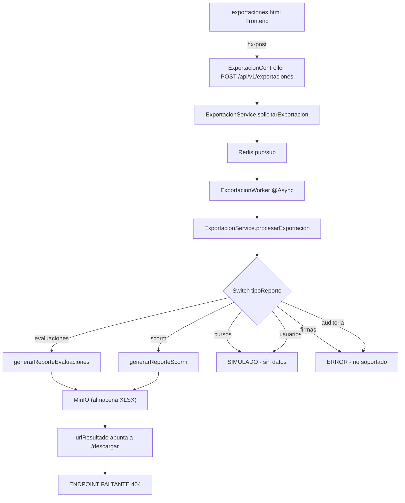

# Plan de Acción: Módulo de Exportaciones (Reportes XLSX)

## Diagnóstico Inicial — Bugs y Problemas Identificados

### 🔴 Bug 1: Endpoint de descarga `/descargar` NO EXISTE
**Archivo:** [`ExportacionController.java`](../src/main/java/com/lms/controller/ExportacionController.java)
**Evidencia:** El servicio [`ExportacionService.generarReporteEvaluaciones()`](../src/main/java/com/lms/service/ExportacionService.java:182) y [`generarReporteScorm()`](../src/main/java/com/lms/service/ExportacionService.java:225) guardan el archivo en MinIO y asignan:
```java
String urlResultado = "/api/v1/exportaciones/" + exportacionId + "/descargar?object=" + objectName;
```
Pero el controlador **no tiene** `@GetMapping("/{id}/descargar")`. El archivo XLSX se genera, se sube a MinIO, pero **no hay forma de descargarlo**. La exportación queda en estado `completado` con una URL que devuelve 404.

### 🔴 Bug 2: Reportes "cursos" y "usuarios" son simulados
**Archivo:** [`ExportacionService.java`](../src/main/java/com/lms/service/ExportacionService.java:248-257)
**Evidencia:** Los cases `cursos` y `usuarios` en el switch de `procesarExportacion()` solo marcan la exportación como `completado` **sin generar ningún archivo XLSX**. No hay consultas a `CursoRepository` ni `UsuarioRepository`.

### 🔴 Bug 3: Reportes "firmas" y "auditoria" no implementados
**Archivo:** [`ExportacionService.java`](../src/main/java/com/lms/service/ExportacionService.java:258-261)
**Evidencia:** El dropdown del template [`exportaciones.html`](../src/main/resources/templates/dashboard/exportaciones.html:93-94) ofrece las opciones `firmas` y `auditoria`, pero el switch no tiene cases para estos tipos → caen en `default` y retornan error *"Tipo de reporte no soportado"*.

### 🟡 Bug 4: HTMX recibe JSON crudo (UX roto)
**Archivo:** [`exportaciones.html`](../src/main/resources/templates/dashboard/exportaciones.html:80)
**Evidencia:** El formulario usa `hx-post="/api/v1/exportaciones"`, pero el controlador retorna `ResponseEntity<Exportacion>` (JSON). HTMX renderiza el JSON como texto plano en `#export-response`. El usuario no ve feedback útil.

### 🟡 Bug 5: Reporte "evaluaciones" incompleto
**Archivo:** [`ExportacionService.java`](../src/main/java/com/lms/service/ExportacionService.java:155-190)
**Evidencia:** Solo lista metadatos de evaluaciones (ID, título, curso, peso, hash). **No incluye:**
- Estado por usuario (aprobado/reprobado)
- Nota final por usuario
- Desglose de respuestas por pregunta

### 🟡 Bug 6: Reporte "scorm" incompleto
**Archivo:** [`ExportacionService.java`](../src/main/java/com/lms/service/ExportacionService.java:197-233)
**Evidencia:** Solo lista metadatos de paquetes SCORM. **No incluye:**
- Usuarios con su porcentaje de avance
- Indicador de quién finalizó al 100%

### 🟡 Bug 7: Sin paginación en consultas
**Evidencia:** Todos los reportes usan `findAll()` que carga TODOS los registros en memoria. Para datasets grandes (>10K registros), esto causará `OutOfMemoryError` o bloqueos largos en la DB.

---

## Diagrama de Arquitectura Actual del Módulo



---

## Plan de Trabajo Detallado

Las tareas están priorizadas por orden de ejecución lógica. Cada una incluye criterio de aceptación verificable.

---

### Tarea 1: Agregar endpoint `GET /{id}/descargar` en ExportacionController

**Archivos a modificar:**
- [`ExportacionController.java`](../src/main/java/com/lms/controller/ExportacionController.java)

**Descripción:** Implementar el endpoint que permite descargar el archivo XLSX almacenado en MinIO. Debe recibir el `object` como query param, obtener el archivo de MinIO y retornarlo como `application/vnd.openxmlformats-officedocument.spreadsheetml.sheet`.

**Criterios de Aceptación:**
- [X] Endpoint `GET /api/v1/exportaciones/{id}/descargar?object={objectName}` existe y responde 200
- [X] Retorna `Content-Disposition: attachment; filename=reporte_{tipo}_{id}.xlsx`
- [X] Retorna `Content-Type: application/vnd.openxmlformats-officedocument.spreadsheetml.sheet`
- [X] Si el object no existe en MinIO, retorna 404
- [X] Verificar con exportación de evaluaciones real: solicitar → esperar completado → descargar → abrir XLSX

---

### Tarea 2: Implementar reporte "cursos" con datos reales

**Archivos a modificar:**
- [`ExportacionService.java`](../src/main/java/com/lms/service/ExportacionService.java)
- Dependencia: [`CursoRepository`](../src/main/java/com/lms/repository/CursoRepository.java)
- Dependencia: [`InscripcionRepository`](../src/main/java/com/lms/repository/InscripcionRepository.java)

**Estructura del reporte (hoja única):**

| Columna | Fuente | Descripción |
|---------|--------|-------------|
| ID Curso | `Curso.id` | UUID del curso |
| Código | `Curso.codigo` | Código alfanumérico (si existe) |
| Título | `Curso.titulo` | Nombre del curso |
| Estado | `Curso.estado` | borrador / publicado / archivado |
| Categoría | `Curso.categoria` | Categoría del curso |
| Versión | `Curso.versionActual` | Versión actual |
| Fecha Creación | `Curso.createdAt` | Timestamp ISO |
| Inscritos | count(`Inscripcion`) | Número de usuarios inscritos |
| Completados | count(`Inscripcion.completado=true`) | Usuarios que completaron |
| Último Acceso | max(`Inscripcion.updatedAt`) | Timestamp del último acceso |

**Criterios de Aceptación:**
- [X] Reemplazar case `cursos` en switch para llamar a `generarReporteCursos(exportacionId)`
- [X] El XLSX generado contiene las columnas especificadas arriba
- [X] Usa `CursoRepository.findByDeletedAtIsNull()` con paginación (Pageable)
- [X] Los valores nulos se muestran como "—"
- [X] El archivo se almacena en MinIO con key `exportaciones/cursos_{exportacionId}.xlsx`

---

### Tarea 3: Implementar reporte "usuarios" con datos reales

**Archivos a modificar:**
- [`ExportacionService.java`](../src/main/java/com/lms/service/ExportacionService.java)
- Dependencia: [`UsuarioRepository`](../src/main/java/com/lms/repository/UsuarioRepository.java)
- Dependencia: [`RolRepository`](../src/main/java/com/lms/repository/RolRepository.java)

**Estructura del reporte (hoja única):**

| Columna | Fuente | Descripción |
|---------|--------|-------------|
| ID Usuario | `Usuario.id` | UUID del usuario |
| Email | `Usuario.email` | Correo electrónico |
| Nombre Completo | `Usuario.nombreCompleto` | Nombre del usuario |
| RUT | `Usuario.rut` | RUT (si tiene) |
| Roles | `Usuario.roles` | Lista de roles separados por coma |
| MFA Habilitado | `Usuario.mfaHabilitado` | Sí/No |
| Consentimiento | `Usuario.consentimientoOtorgado` | Sí/No |
| Último Login | `Usuario.ultimoLogin` | Timestamp ISO |
| Creado | `Usuario.createdAt` | Fecha de registro |
| Hash SHA-256 | `Usuario.hashSha256` | Hash de integridad |

**Criterios de Aceptación:**
- [X] Reemplazar case `usuarios` en switch para llamar a `generarReporteUsuarios(exportacionId)`
- [X] El XLSX contiene las columnas especificadas
- [X] Usa `UsuarioRepository.findAllActive()` con paginación
- [X] Los roles se concatenan en una sola celda separados por coma
- [X] Archivo almacenado en `exportaciones/usuarios_{exportacionId}.xlsx`

---

### Tarea 4: Implementar reporte "firmas electrónicas"

**Archivos a modificar:**
- [`ExportacionService.java`](../src/main/java/com/lms/service/ExportacionService.java)
- Dependencia: [`FirmaElectronicaRepository`](../src/main/java/com/lms/repository/FirmaElectronicaRepository.java)
- Dependencia: [`UsuarioRepository`](../src/main/java/com/lms/repository/UsuarioRepository.java)
- Dependencia: [`DocumentoRepository`](../src/main/java/com/lms/repository/DocumentoRepository.java)

**Estructura del reporte (hoja única):**

| Columna | Fuente | Descripción |
|---------|--------|-------------|
| ID Firma | `FirmaElectronica.id` | UUID de la firma |
| ID Documento | `FirmaElectronica.documento.id` | UUID del documento firmado |
| Nombre Documento | `Documento.nombre` | Nombre del documento |
| Firmante ID | `FirmaElectronica.usuario.id` | UUID del firmante |
| Firmante Nombre | `Usuario.nombreCompleto` | Nombre del firmante |
| Firmante Email | `Usuario.email` | Email del firmante |
| IP Origen | `FirmaElectronica.ipOrigen` | IP desde donde firmó |
| Timestamp | `FirmaElectronica.timestamp` | Fecha/hora de la firma |
| User-Agent | `FirmaElectronica.userAgent` | Navegador/dispositivo |
| SO | `FirmaElectronica.sistemaOperativo` | Sistema operativo |
| Geolocalización | `FirmaElectronica.geolocalizacion` | Ubicación (si aplica) |
| Hash Documento | `FirmaElectronica.hashDocumento` | Hash SHA-256 del documento |
| Hash Firma | `FirmaElectronica.hashSha256` | Hash de integridad de la firma |

**Criterios de Aceptación:**
- [X] Agregar case `firmas` en switch → `generarReporteFirmas(exportacionId)`
- [X] Inyectar `FirmaElectronicaRepository` en `ExportacionService`
- [X] Inyectar `DocumentoRepository` en `ExportacionService`
- [X] El XLSX contiene todas las columnas especificadas
- [X] Archivo almacenado en `exportaciones/firmas_{exportacionId}.xlsx`

---

### Tarea 5: Implementar reporte "auditoría"

**Archivos a modificar:**
- [`ExportacionService.java`](../src/main/java/com/lms/service/ExportacionService.java)
- Dependencia: [`EventoAuditoriaRepository`](../src/main/java/com/lms/repository/EventoAuditoriaRepository.java)

**Estructura del reporte (hoja única):**

| Columna | Fuente | Descripción |
|---------|--------|-------------|
| ID Evento | `EventoAuditoria.id` | UUID del evento |
| Tipo Evento | `EventoAuditoria.tipoEvento` | Tipo (LOGIN, EXPORTACION, FIRMA, etc.) |
| Actor ID | `EventoAuditoria.actorId` | UUID del usuario que realizó la acción |
| Acción | `EventoAuditoria.accion` | Acción realizada |
| Recurso Tipo | `EventoAuditoria.recursoTipo` | Tipo de recurso afectado |
| Recurso ID | `EventoAuditoria.recursoId` | UUID del recurso |
| Metadata | `EventoAuditoria.metadata` | JSON de metadatos (serializado) |
| Hash Anterior | `EventoAuditoria.hashAnterior` | Hash del evento anterior (cadena) |
| Hash SHA-256 | `EventoAuditoria.hashSha256` | Hash de integridad |
| Creado | `EventoAuditoria.createdAt` | Timestamp ISO |

**Criterios de Aceptación:**
- [X] Agregar case `auditoria` en switch → `generarReporteAuditoria(exportacionId)`
- [X] Inyectar `EventoAuditoriaRepository` en `ExportacionService`
- [X] Usa `findAllOrderByCreatedAtDesc()` con paginación
- [X] La metadata JSON se serializa como string legible en la celda
- [X] Archivo almacenado en `exportaciones/auditoria_{exportacionId}.xlsx`

---

### Tarea 6: Enriquecer reporte "evaluaciones" con datos por usuario

**Archivos a modificar:**
- [`ExportacionService.java`](../src/main/java/com/lms/service/ExportacionService.java)
- Dependencia: [`InscripcionRepository`](../src/main/java/com/lms/repository/InscripcionRepository.java)
- Dependencia: [`PreguntaRepository`](../src/main/java/com/lms/repository/PreguntaRepository.java)
- Dependencia: [`EvaluacionRepository`](../src/main/java/com/lms/repository/EvaluacionRepository.java)

**Estructura del reporte (hoja 1 - Resumen por evaluación):**

| Columna | Descripción |
|---------|-------------|
| ID Evaluación | UUID |
| Código | Código alfanumérico |
| Título | Nombre de la evaluación |
| Curso ID | UUID del curso |
| Curso Título | Nombre del curso |
| Peso Total | Peso en % |
| N° Preguntas | Conteo de preguntas |
| Creado | Timestamp |

**Estructura del reporte (hoja 2 - Resultados por usuario):**

| Columna | Descripción |
|---------|-------------|
| ID Evaluación | UUID |
| ID Usuario | UUID del estudiante |
| Email | Email del estudiante |
| Nombre | Nombre del estudiante |
| Estado | Aprobado / Reprobado / Pendiente |
| Nota Final | Nota numérica |
| Intentos | Número de intentos |
| Fecha Completado | Timestamp |

**Estructura del reporte (hoja 3 - Detalle respuestas):**

| Columna | Descripción |
|---------|-------------|
| ID Evaluación | UUID |
| ID Usuario | UUID del estudiante |
| Pregunta N° | Número de orden |
| Pregunta | Contenido de la pregunta |
| Tipo | única / múltiple / V/F |
| Respuesta Usuario | Lo que respondió |
| Respuesta Correcta | La respuesta correcta |
| Peso | Peso de la pregunta |
| Acertó | Sí / No |

**Criterios de Aceptación:**
- [X] El reporte genera 3 hojas (Resumen, Resultados, Detalle)
- [X] Hoja 1 mantiene las columnas actuales + N° Preguntas + Curso Título
- [X] Hoja 2 usa `InscripcionRepository` para obtener usuarios por evaluación
- [X] Hoja 3 cruza respuestas de usuarios con preguntas
- [X] Archivo almacenado en `exportaciones/evaluaciones_{exportacionId}.xlsx`

---

### Tarea 7: Enriquecer reporte "scorm" con progreso por usuario

**Archivos a modificar:**
- [`ExportacionService.java`](../src/main/java/com/lms/service/ExportacionService.java)
- Dependencia: [`ScormDatoAlumnoRepository`](../src/main/java/com/lms/repository/ScormDatoAlumnoRepository.java)

**Estructura del reporte (hoja 1 - Paquetes):**

| Columna | Descripción |
|---------|-------------|
| ID Paquete | UUID |
| Código | Código alfanumérico |
| Título | Nombre del paquete |
| Curso ID | UUID del curso |
| Versión SCORM | Versión (2004 3rd Ed, etc.) |
| Tamaño | Bytes |
| Hash | SHA-256 |
| Creado | Timestamp |

**Estructura del reporte (hoja 2 - Progreso por usuario):**

| Columna | Descripción |
|---------|-------------|
| ID Paquete | UUID |
| Título Paquete | Nombre del paquete |
| ID Usuario | UUID del estudiante |
| Email | Email del estudiante |
| % Avance | Porcentaje (0-100) |
| Finalizó 100% | Sí / No |
| Último Acceso | Timestamp |

**Criterios de Aceptación:**
- [X] El reporte genera 2 hojas (Paquetes, Progreso)
- [X] Hoja 2 cruza `ScormDatoAlumno` con usuarios para obtener avance
- [X] La columna "% Avance" se calcula de `cmi.core.lesson_status` o `cmi.completion_status`
- [X] "Finalizó 100%" se marca Sí cuando `cmi.core.lesson_status = completed` o `cmi.completion_status = completed`
- [X] Archivo almacenado en `exportaciones/scorm_{exportacionId}.xlsx`

---

### Tarea 8: Corregir feedback HTMX en el frontend

**Archivos a modificar:**
- [`exportaciones.html`](../src/main/resources/templates/dashboard/exportaciones.html)

**Descripción:** El formulario HTMX recibe JSON crudo. Se debe cambiar el approach: usar `hx-trigger="submit"` con `hx-target="#export-response"` y manejar la respuesta JSON mediante un `hx-on` o cambiar el endpoint para que retorne HTML parcial.

**Opción recomendada:** Mantener el endpoint JSON pero cambiar el frontend para usar JavaScript (fetch) en lugar de HTMX para el submit, mostrando feedback visual (toast o badge) con el estado de la solicitud.

**Criterios de Aceptación:**
- [X] Al solicitar una exportación, el usuario ve feedback visual (no JSON crudo)
- [X] Si la solicitud es exitosa, muestra badge "Pendiente" y refresca la lista
- [X] Si hay error, muestra mensaje de error en rojo
- [X] La lista de exportaciones se refresca automáticamente después de solicitar

---

### Tarea 9: Agregar paginación en consultas de reportes

**Archivos a modificar:**
- [`ExportacionService.java`](../src/main/java/com/lms/service/ExportacionService.java)
- [`ExportacionController.java`](../src/main/java/com/lms/controller/ExportacionController.java)
- Repositorios: CursoRepository, UsuarioRepository, EventoAuditoriaRepository, etc.

**Descripción:** Reemplazar `findAll()` por consultas paginadas con `Pageable`. Procesar en lotes de 1000 registros para evitar `OutOfMemoryError` con datasets grandes.

**Criterios de Aceptación:**
- [X] Ningún reporte usa `findAll()` sin paginación
- [X] Los reportes procesan en lotes de max 1000 registros por iteración
- [X] El XLSX se escribe en streaming (SXSSFWorkbook) para datasets >1000 filas
- [X] El progreso se loguea cada 1000 registros procesados
- [X] Si hay más de 10,000 registros, se muestra advertencia en log

---

### Tarea 10: Validación de datos antes de generar XLSX

**Archivos a modificar:**
- [`ExportacionService.java`](../src/main/java/com/lms/service/ExportacionService.java)

**Descripción:** Agregar validaciones pre-generación para evitar archivos corruptos o vacíos.

**Criterios de Aceptación:**
- [X] Si la consulta retorna 0 registros, la exportación pasa a estado `completado` con mensaje "Sin datos para el reporte solicitado"
- [X] Si hay error en la consulta, la exportación pasa a `error` con el mensaje de la excepción
- [X] Se valida que el `tipoReporte` no sea null o vacío antes de procesar
- [X] Se valida que `exportacionId` exista en BD antes de generar

---

## Resumen de Archivos a Modificar

| Archivo | Tareas | Tipo de Cambio |
|---------|--------|----------------|
| [`ExportacionController.java`](../src/main/java/com/lms/controller/ExportacionController.java) | T1 | Agregar endpoint descarga |
| [`ExportacionService.java`](../src/main/java/com/lms/service/ExportacionService.java) | T2, T3, T4, T5, T6, T7, T9, T10 | Implementar reportes, paginación, validaciones |
| [`exportaciones.html`](../src/main/resources/templates/dashboard/exportaciones.html) | T8 | Corregir feedback HTMX |
| (ninguno - repos ya existen) | T2-T7 | Solo inyectar dependencias existentes |

## Dependencias a Inyectar en ExportacionService

```java
// Ya existe:
private final ExportacionRepository exportacionRepository;
private final EvaluacionRepository evaluacionRepository;
private final PaqueteScormRepository paqueteScormRepository;
private final MinioClient minioClient;
private final AuditLogger auditLogger;
private final RedisTemplate<String, String> redisTemplate;

// Nuevas (todas existen en el proyecto):
private final CursoRepository cursoRepository;           // T2
private final InscripcionRepository inscripcionRepository; // T2, T6
private final UsuarioRepository usuarioRepository;        // T3
private final FirmaElectronicaRepository firmaRepository; // T4
private final DocumentoRepository documentoRepository;    // T4
private final EventoAuditoriaRepository auditoriaRepository; // T5
private final PreguntaRepository preguntaRepository;      // T6
private final ScormDatoAlumnoRepository scormDatoRepository; // T7
```

## Estructura de Métodos a Implementar

| Método | Tarea | Descripción |
|--------|-------|-------------|
| `generarReporteCursos(UUID exportacionId)` | T2 | Reporte de cursos con inscritos |
| `generarReporteUsuarios(UUID exportacionId)` | T3 | Reporte de usuarios con roles |
| `generarReporteFirmas(UUID exportacionId)` | T4 | Reporte de firmas electrónicas |
| `generarReporteAuditoria(UUID exportacionId)` | T5 | Reporte de auditoría |
| `generarReporteEvaluacionesV2(UUID exportacionId)` | T6 | Versión enriquecida con 3 hojas |
| `generarReporteScormV2(UUID exportacionId)` | T7 | Versión enriquecida con 2 hojas |
| `generarExcelStreaming(String[] headers, Iterator<String[]> dataIterator)` | T9 | Generación con SXSSFWorkbook |
| `validarExportacion(UUID exportacionId)` | T10 | Validaciones pre-generación |
