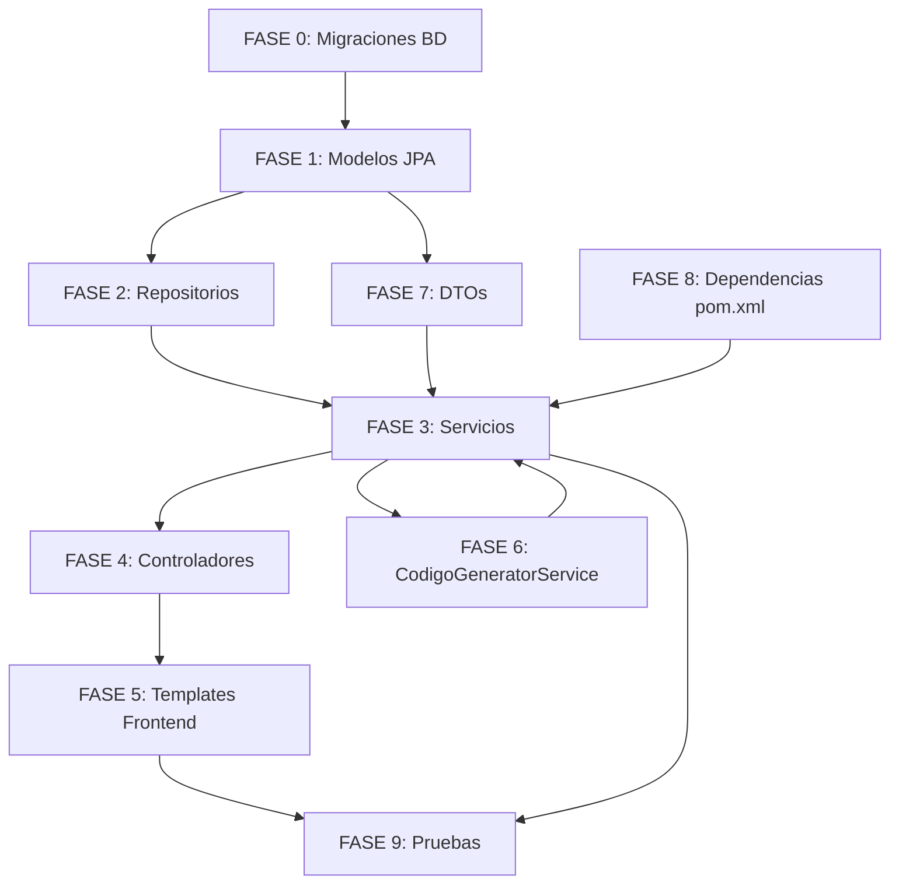

# 🎯 MEJORA CONTINUA — LMS LegalTech

> **Propósito**: Checklist de tareas para implementar los 7 requerimientos de mejora continua.
> Cada tarea marcada con `[X]` indica que está completada.
> Basado en análisis de [`LMS.md`](../LMS.md), [`RESUMEN_TRABAJO_NOCTURNO.md`](../RESUMEN_TRABAJO_NOCTURNO.md), [`data-model.md`](../specs/001-lms-core/data-model.md) y código fuente existente.

---

## 📋 ANÁLISIS DE REQUERIMIENTOS

### Req 1 — Cursos: Inscripción, Documentos, Fecha Límite, Alertas y Estado
| # | Sub-requerimiento | ¿Aplicable? | Alineación con specs |
|---|------------------|:-----------:|---------------------|
| 1.1 | Botón "Inscribir Participantes" (manual 1-to-1 + bulk XLSX/CSV) | ✅ Sí | Nuevo flujo. No existe entidad `Inscripcion`. Requiere nueva migración, modelo, repositorio, servicio y controlador. |
| 1.2 | Botón "Documentos" en cards de cursos | ✅ Sí | No existe relación `Curso` ↔ `Documento`. Requiere nueva tabla intermedia `cursos_documentos`. |
| 1.3 | Campo "fecha límite realización" en creación/edición de cursos | ✅ Sí | No existe campo `fecha_limite` en `cursos`. Requiere migración `ALTER TABLE` + nuevo campo en `Curso.java` + `CursoRequest.java`. |
| 1.4 | Alertas de cursos próximos a vencer en perfil del usuario | ✅ Sí | Requiere nueva lógica de consulta en `Inscripcion` + endpoint HTMX para perfil. |
| 1.5 | Indicador "curso realizado" con estado de completitud | ✅ Sí | Requiere campo `completado` y `nota` en `Inscripcion` (o entidad separada de progreso). |
| 1.6 | Consistencia emoji/icons en UI | ✅ Sí | Ajuste en templates Thymeleaf existentes. |

### Req 2 — Documentos: Biblioteca Contenedora por Curso
| # | Sub-requerimiento | ¿Aplicable? | Alineación con specs |
|---|------------------|:-----------:|---------------------|
| 2.1 | Vista "biblioteca/contenedora" accesible desde cada curso | ✅ Sí | Requiere nueva vista Thymeleaf `/cursos/{id}/documentos` + endpoint controller. |
| 2.2 | Vincular documentos existentes a cursos | ✅ Sí | Requiere lógica en `DocumentoService` para asociar documentos existentes. |
| 2.3 | Subir nuevos documentos directamente desde el curso | ✅ Sí | Reutiliza `DocumentoService.subirDocumento()` existente, agregando asociación al curso. |

### Req 3 — SCORM: Paquetes dentro de Cursos, Visibilidad por Asignación
| # | Sub-requerimiento | ¿Aplicable? | Alineación con specs |
|---|------------------|:-----------:|---------------------|
| 3.1 | Paquetes SCORM almacenados dentro del curso | ✅ Sí | Ya existe `PaqueteScorm.cursoId` (UUID). Mejorar a `@ManyToOne`. |
| 3.2 | Estudiantes ven solo cursos asignados | ✅ Sí | Filtro por `Inscripcion.usuarioId` en queries de cursos. |
| 3.3 | Acceso a SCORM desde la vista del curso | ✅ Sí | Ajustar template de detalle de curso para mostrar SCORM asociados. |

### Req 4 — Consentimiento Informado: Mensaje de Éxito Post-Firma
| # | Sub-requerimiento | ¿Aplicable? | Alineación con specs |
|---|------------------|:-----------:|---------------------|
| 4.1 | Mostrar "Consentimiento firmado exitosamente" tras firmar | ✅ Sí | Template [`consentimiento.html`](../src/main/resources/templates/auth/consentimiento.html) no muestra estado de éxito. Agregar condición Thymeleaf `th:if` y fragmento de éxito. |

### Req 5 — Evaluaciones: ID Alfanumérico Correlativo
| # | Sub-requerimiento | ¿Aplicable? | Alineación con specs |
|---|------------------|:-----------:|---------------------|
| 5.1 | Generar ID correlativo `EVA00+` para evaluaciones | ✅ Sí | Nuevo campo `codigo` en `Evaluacion.java`. Migración `ALTER TABLE evaluaciones ADD COLUMN codigo VARCHAR(20)`. |
| 5.2 | Generar ID correlativo `SCO00+` para paquetes SCORM | ✅ Sí | Nuevo campo `codigo` en `PaqueteScorm.java`. Migración similar. |
| 5.3 | Generar ID correlativo `DOC00+` para documentos | ✅ Sí | Nuevo campo `codigo` en `Documento.java`. Migración similar. |
| 5.4 | Búsqueda por estos IDs alfanuméricos | ✅ Sí | Nuevos métodos en repositorios (`findByCodigo`) + endpoints de búsqueda. |

### Req 6 — Exportaciones: Reportes de Evaluaciones y SCORM
| # | Sub-requerimiento | ¿Aplicable? | Alineación con specs |
|---|------------------|:-----------:|---------------------|
| 6.1 | Agregar reporte "evaluaciones" al selector de tipo | ✅ Sí | Agregar opción en [`exportaciones.html`](../src/main/resources/templates/dashboard/exportaciones.html) + lógica en `ExportacionWorker`. |
| 6.2 | Agregar reporte "scorm" al selector de tipo | ✅ Sí | Similar al anterior. |
| 6.3 | Búsqueda por ID alfanumérico para filtrar reportes | ✅ Sí | Nuevo parámetro `filtros` ya existe en `Exportacion`. Mejorar parsing de filtros. |

### Req 7 — Mi Perfil: Cursos Asignados, Pendientes y Completados
| # | Sub-requerimiento | ¿Aplicable? | Alineación con specs |
|---|------------------|:-----------:|---------------------|
| 7.1 | Sección "Mis Cursos" en perfil del usuario | ✅ Sí | Agregar sección en [`perfil.html`](../src/main/resources/templates/dashboard/perfil.html) con endpoint HTMX. |
| 7.2 | Cursos pendientes con alerta de fecha límite y cuenta regresiva | ✅ Sí | Lógica de countdown desde `fecha_limite` + template con badge de alerta. |
| 7.3 | Cursos completados con nota de evaluación | ✅ Sí | Consultar `Inscripcion.nota` + `Inscripcion.completado` para mostrar historial. |

---

## 📦 PLAN DE IMPLEMENTACIÓN POR MÓDULOS

### FASE 0 — PREPARACIÓN Y MIGRACIONES (Base de Datos)

- [ ] **M0.1** — Crear migración `V6__mejora_continua.sql` con:
  - `ALTER TABLE cursos ADD COLUMN fecha_limite TIMESTAMP;`
  - Crear tabla `inscripciones` (id UUID, curso_id UUID FK, usuario_id UUID FK, completado BOOLEAN, nota DOUBLE, fecha_limite TIMESTAMP, created_at TIMESTAMP, hash_sha256 VARCHAR(64), UNIQUE curso_id + usuario_id)
  - Crear tabla `cursos_documentos` (curso_id UUID FK, documento_id UUID FK, PRIMARY KEY compuesta)
  - `ALTER TABLE evaluaciones ADD COLUMN codigo VARCHAR(20) UNIQUE;`
  - `ALTER TABLE paquetes_scorm ADD COLUMN codigo VARCHAR(20) UNIQUE;`
  - `ALTER TABLE documentos ADD COLUMN codigo VARCHAR(20) UNIQUE;`
  - Crear secuencias/triggers para auto-generación de códigos correlativos
  - Migrar datos existentes: actualizar `PaqueteScorm.curso_id` a FK explícita si no existe

### FASE 1 — MODELOS JPA

- [ ] **M1.1** — Agregar campo `fechaLimite` (LocalDateTime) en [`Curso.java`](../src/main/java/com/lms/model/Curso.java)
- [ ] **M1.2** — Crear entidad [`Inscripcion.java`](../src/main/java/com/lms/model/Inscripcion.java):
  - id (UUID PK), curso (@ManyToOne Curso), usuario (@ManyToOne Usuario), completado (boolean), nota (Double), fechaLimite (LocalDateTime), hashSha256, createdAt, deletedAt
- [ ] **M1.3** — Crear entidad [`CursoDocumento.java`](../src/main/java/com/lms/model/CursoDocumento.java):
  - curso (@ManyToOne Curso), documento (@ManyToOne Documento), PK compuesta vía `@IdClass`
- [ ] **M1.4** — Agregar campo `codigo` (String) en [`Evaluacion.java`](../src/main/java/com/lms/model/Evaluacion.java)
- [ ] **M1.5** — Agregar campo `codigo` (String) en [`PaqueteScorm.java`](../src/main/java/com/lms/model/PaqueteScorm.java)
- [ ] **M1.6** — Agregar campo `codigo` (String) en [`Documento.java`](../src/main/java/com/lms/model/Documento.java)
- [ ] **M1.7** — Agregar `@OneToMany`/`@ManyToMany` para documentos en [`Curso.java`](../src/main/java/com/lms/model/Curso.java)
- [ ] **M1.8** — Mejorar relación `PaqueteScorm → Curso` de UUID plano a `@ManyToOne`

### FASE 2 — REPOSITORIOS

- [ ] **M2.1** — Crear [`InscripcionRepository.java`](../src/main/java/com/lms/repository/InscripcionRepository.java) con:
  - `findByUsuarioId(UUID usuarioId)`
  - `findByCursoId(UUID cursoId)`
  - `findByUsuarioIdAndCursoId(UUID usuarioId, UUID cursoId)`
  - `countByUsuarioIdAndCompletadoTrue(UUID usuarioId)`
  - `countByUsuarioIdAndCompletadoFalse(UUID usuarioId)`
- [ ] **M2.2** — Crear [`CursoDocumentoRepository.java`](../src/main/java/com/lms/repository/CursoDocumentoRepository.java) con:
  - `findByCursoId(UUID cursoId)`
- [ ] **M2.3** — Agregar `findByCodigo(String codigo)` en [`EvaluacionRepository.java`](../src/main/java/com/lms/repository/EvaluacionRepository.java)
- [ ] **M2.4** — Agregar `findByCodigo(String codigo)` en [`PaqueteScormRepository.java`](../src/main/java/com/lms/repository/PaqueteScormRepository.java)
- [ ] **M2.5** — Agregar `findByCodigo(String codigo)` en [`DocumentoRepository.java`](../src/main/java/com/lms/repository/DocumentoRepository.java)

### FASE 3 — SERVICIOS

- [ ] **M3.1** — Crear [`InscripcionService.java`](../src/main/java/com/lms/service/InscripcionService.java):
  - `inscribirUsuario(UUID cursoId, UUID usuarioId)` — inscripción 1-to-1
  - `inscribirMasivo(UUID cursoId, MultipartFile xlsx)` — bulk via XLSX/CSV
  - `listarMisCursos(UUID usuarioId)` — para perfil
  - `listarPendientes(UUID usuarioId)` — con fecha límite
  - `completarCurso(UUID inscripcionId, Double nota)` — marcar como realizado
  - `marcarCompletado(UUID cursoId, UUID usuarioId, Double nota)` — completar curso
- [ ] **M3.2** — Actualizar [`CursoService.java`](../src/main/java/com/lms/service/CursoService.java):
  - Agregar `fechaLimite` en `crearCurso()` y `actualizarCurso()`
  - Agregar `listarCursosPorUsuario(UUID usuarioId)` con filtro por inscripciones activas
- [ ] **M3.3** — Actualizar [`DocumentoService.java`](../src/main/java/com/lms/service/DocumentoService.java):
  - Agregar `subirDocumentoParaCurso(MultipartFile file, UUID cursoId, UUID usuarioId)`
  - Agregar `vincularDocumentoACurso(UUID documentoId, UUID cursoId)`
  - Agregar `listarDocumentosPorCurso(UUID cursoId)`
  - Agregar lógica de generación de `codigo` (DOC00+)
- [ ] **M3.4** — Actualizar [`ScormService.java`](../src/main/java/com/lms/service/ScormService.java):
  - Agregar lógica de generación de `codigo` (SCO00+)
- [ ] **M3.5** — Actualizar [`EvaluacionService.java`](../src/main/java/com/lms/service/EvaluacionService.java):
  - Agregar lógica de generación de `codigo` (EVA00+)
- [ ] **M3.6** — Actualizar [`ExportacionService.java`](../src/main/java/com/lms/service/ExportacionService.java):
  - Agregar generación de reporte "evaluaciones" (XLSX)
  - Agregar generación de reporte "scorm" (XLSX)
- [ ] **M3.7** — Actualizar [`ExportacionWorker.java`](../src/main/java/com/lms/service/ExportacionWorker.java):
  - Agregar lógica de procesamiento para reportes "evaluaciones" y "scorm"
- [ ] **M3.8** — Actualizar [`ConsentimientoService.java`](../src/main/java/com/lms/service/ConsentimientoService.java):
  - Agregar método `haOtorgadoConsentimiento(UUID usuarioId)` retornando `boolean`
  - Agregar método `obtenerUltimoConsentimiento(UUID usuarioId)` para mostrar estado

### FASE 4 — CONTROLADORES

- [ ] **M4.1** — Crear [`InscripcionController.java`](../src/main/java/com/lms/controller/InscripcionController.java) (REST + HTMX):
  - `POST /api/v1/cursos/{cursoId}/inscribir` — inscribir usuario
  - `POST /api/v1/cursos/{cursoId}/inscribir-masivo` — bulk upload
  - `GET /api/v1/mis-cursos` — listar cursos del usuario autenticado
  - `GET /hx/perfil/cursos` — fragmento HTMX para perfil
  - `POST /api/v1/cursos/{cursoId}/completar` — marcar completado
- [ ] **M4.2** — Actualizar [`CursoController.java`](../src/main/java/com/lms/controller/CursoController.java):
  - Agregar `GET /api/v1/cursos/mis-cursos` — solo cursos asignados al usuario
  - Agregar `fechaLimite` en DTO de creación/actualización
- [ ] **M4.3** — Actualizar [`CursoHtmxController.java`](../src/main/java/com/lms/controller/CursoHtmxController.java):
  - Agregar filtro por usuario logueado en fragmento de listado
- [ ] **M4.4** — Crear [`DocumentoCursoController.java`](../src/main/java/com/lms/controller/DocumentoCursoController.java):
  - `GET /cursos/{cursoId}/documentos` — vista de biblioteca de documentos
  - `POST /cursos/{cursoId}/documentos/subir` — subir documento al curso
  - `POST /cursos/{cursoId}/documentos/vincular` — vincular documento existente
- [ ] **M4.5** — Actualizar [`ScormController.java`](../src/main/java/com/lms/controller/ScormController.java):
  - Agregar soporte de búsqueda por `codigo`
- [ ] **M4.6** — Actualizar [`EvaluacionController.java`](../src/main/java/com/lms/controller/EvaluacionController.java):
  - Agregar soporte de búsqueda por `codigo`
- [ ] **M4.7** — Actualizar [`ExportacionController.java`](../src/main/java/com/lms/controller/ExportacionController.java):
  - Soportar filtros por `codigo` alfanumérico

### FASE 5 — TEMPLATES Y FRONTEND (Thymeleaf + HTMX)

- [ ] **M5.1** — Actualizar [`cursos/fragmentos.html`](../src/main/resources/templates/cursos/fragmentos.html):
  - Agregar botón "📄 Documentos" en la sección de acciones de cada card
  - Agregar botón "📋 Inscribir" (solo para ADMIN/INSTRUCTOR)
  - Mostrar `fechaLimite` si existe (formateada + badge)
  - Mostrar indicador "✅ Realizado" si el usuario completó el curso
  - Consistencia de emojis/icons
- [ ] **M5.2** — Actualizar [`cursos/listado.html`](../src/main/resources/templates/cursos/listado.html):
  - Agregar filtro/buscador por `codigo` alfanumérico
- [ ] **M5.3** — Actualizar [`cursos/editor.html`](../src/main/resources/templates/cursos/editor.html):
  - Agregar campo "Fecha Límite de Realización" (input datetime-local)
- [ ] **M5.4** — Actualizar [`dashboard/perfil.html`](../src/main/resources/templates/dashboard/perfil.html):
  - Agregar sección "📚 Mis Cursos" con:
    - Cursos pendientes (alerta + countdown desde `fechaLimite`)
    - Cursos completados (check + nota de evaluación)
    - Fragmento HTMX cargado desde `/hx/perfil/cursos`
- [ ] **M5.5** — Actualizar [`auth/consentimiento.html`](../src/main/resources/templates/auth/consentimiento.html):
  - Agregar estado "✅ Consentimiento firmado exitosamente" cuando `consentimiento.aceptado == true`
  - Mostrar fecha de firma y versión de política
  - Ocultar formulario si ya firmó
- [ ] **M5.6** — Actualizar [`dashboard/exportaciones.html`](../src/main/resources/templates/dashboard/exportaciones.html):
  - Agregar opciones "evaluaciones" y "scorm" al dropdown `tipoReporte`
  - Agregar campo de filtro por `codigo` alfanumérico
- [ ] **M5.7** — Crear template [`cursos/documentos.html`](../src/main/resources/templates/cursos/documentos.html):
  - Biblioteca de documentos del curso
  - Listado de documentos vinculados (nombre, tipo, tamaño, fecha)
  - Botón "Subir Documento" + "Vincular Existente"
- [ ] **M5.8** — Crear template [`cursos/inscripcion.html`](../src/main/resources/templates/cursos/inscripcion.html):
  - Formulario de inscripción manual (input email/usuario)
  - Formulario de carga masiva (XLSX/CSV)
  - Listado de participantes inscritos

### FASE 6 — SERVICIO DE GENERACIÓN DE CÓDIGOS ALFANUMÉRICOS

- [ ] **M6.1** — Crear [`CodigoGeneratorService.java`](../src/main/java/com/lms/service/CodigoGeneratorService.java):
  - Método `generarCodigo(String prefijo)` → ej: `EVA001`, `SCO042`, `DOC153`
  - Usar contador desde BD (tabla `secuencias_codigos` o query `SELECT COUNT(*) + 1`)
  - Formato de 3 dígitos: `{PREFIJO}{NUMERO}` con padding a 3 dígitos

### FASE 7 — DTOs

- [ ] **M7.1** — Agregar campo `fechaLimite` (String ISO) en [`CursoRequest.java`](../src/main/java/com/lms/dto/CursoRequest.java)
- [ ] **M7.2** — Crear [`InscripcionRequest.java`](../src/main/java/com/lms/dto/InscripcionRequest.java):
  - `usuarioId` o `email` (UUID o String)
- [ ] **M7.3** — Crear [`InscripcionResponse.java`](../src/main/java/com/lms/dto/InscripcionResponse.java):
  - `id`, `cursoId`, `cursoTitulo`, `usuarioId`, `usuarioNombre`, `completado`, `nota`, `fechaLimite`

### FASE 8 — ACTUALIZACIÓN DE DEPENDENCIAS (pom.xml)

- [ ] **M8.1** — Verificar que Apache POI esté en [`pom.xml`](../pom.xml) para exportación XLSX
- [ ] **M8.2** — Agregar dependencia para parsing de XLSX/CSV (Apache POI o Apache Commons CSV) si no existe

### FASE 9 — PRUEBAS

- [ ] **M9.1** — Tests unitarios para [`InscripcionService`](../src/main/java/com/lms/service/InscripcionService.java)
- [ ] **M9.2** — Tests unitarios para [`CodigoGeneratorService`](../src/main/java/com/lms/service/CodigoGeneratorService.java)
- [ ] **M9.3** — Tests de integración para nuevos endpoints REST
- [ ] **M9.4** — Tests de exportación para reportes evaluaciones y scorm

---

## 🔄 MAPA DE DEPENDENCIAS ENTRE FASES

---

## 🧩 MAPA DE NUEVOS ARCHIVOS

| Archivo | Tipo | Propósito |
|---------|------|-----------|
| `V6__mejora_continua.sql` | Migración Flyway | Nuevas tablas y columnas |
| `Inscripcion.java` | Modelo JPA | Entidad de inscripción/participación |
| `CursoDocumento.java` | Modelo JPA | Join table Curso-Documento |
| `InscripcionRepository.java` | Repositorio | Queries de inscripciones |
| `CursoDocumentoRepository.java` | Repositorio | Queries de documentos por curso |
| `InscripcionService.java` | Servicio | Lógica de inscripciones |
| `CodigoGeneratorService.java` | Servicio | Generación de IDs alfanuméricos |
| `InscripcionController.java` | Controlador | Endpoints REST de inscripciones |
| `DocumentoCursoController.java` | Controlador | Endpoints documentos-curso |
| `InscripcionRequest.java` | DTO | Request de inscripción |
| `InscripcionResponse.java` | DTO | Response de inscripción |
| `cursos/documentos.html` | Template | Biblioteca de documentos del curso |
| `cursos/inscripcion.html` | Template | Gestión de inscripciones |

## 🧩 MAPA DE ARCHIVOS MODIFICADOS

| Archivo | Cambios |
|---------|---------|
| `V1__initial_schema.sql` | Referencia para entender esquema actual (sin cambios) |
| `Curso.java` | +fechaLimite, +@ManyToMany documentos, +@OneToMany inscripciones |
| `Evaluacion.java` | +codigo |
| `PaqueteScorm.java` | +codigo, +@ManyToOne Curso |
| `Documento.java` | +codigo, +@ManyToMany cursos |
| `Usuario.java` | +@OneToMany inscripciones |
| `CursoRequest.java` | +fechaLimite |
| `CursoService.java` | +fechaLimite, +listarPorUsuario |
| `DocumentoService.java` | +subirParaCurso, +vincular, +listarPorCurso |
| `ScormService.java` | +generarCodigo |
| `EvaluacionService.java` | +generarCodigo |
| `ExportacionService.java` | +reporteEvaluaciones, +reporteScorm |
| `ExportacionWorker.java` | +procesarEvaluaciones, +procesarScorm |
| `CursoController.java` | +mis-cursos, +fechaLimite |
| `CursoHtmxController.java` | +filtro por usuario |
| `ScormController.java` | +búsqueda por codigo |
| `EvaluacionController.java` | +búsqueda por codigo |
| `ExportacionController.java` | +filtro codigo |
| `cursos/fragmentos.html` | +botones Documentos/Inscribir, +fechaLimite, +estado |
| `cursos/listado.html` | +buscador por codigo |
| `cursos/editor.html` | +campo fechaLimite |
| `dashboard/perfil.html` | +sección Mis Cursos |
| `auth/consentimiento.html` | +estado de éxito post-firma |
| `dashboard/exportaciones.html` | +evaluaciones/scorm, +filtro codigo |
| `CursoHtmxController.java` | +endpoint fragmento perfil |
| `Evaluacion.java` entity | +campo codigo |
| `PaqueteScorm.java` entity | +campo codigo |
| `Documento.java` entity | +campo codigo |
| `pom.xml` | Verificar dependencias Apache POI/CSV |

---

## 📊 LEYENDA

| Símbolo | Significado |
|:-------:|-------------|
| `[ ]` | Pendiente por implementar |
| `[X]` | Completado |
| `[~]` | En progreso |
