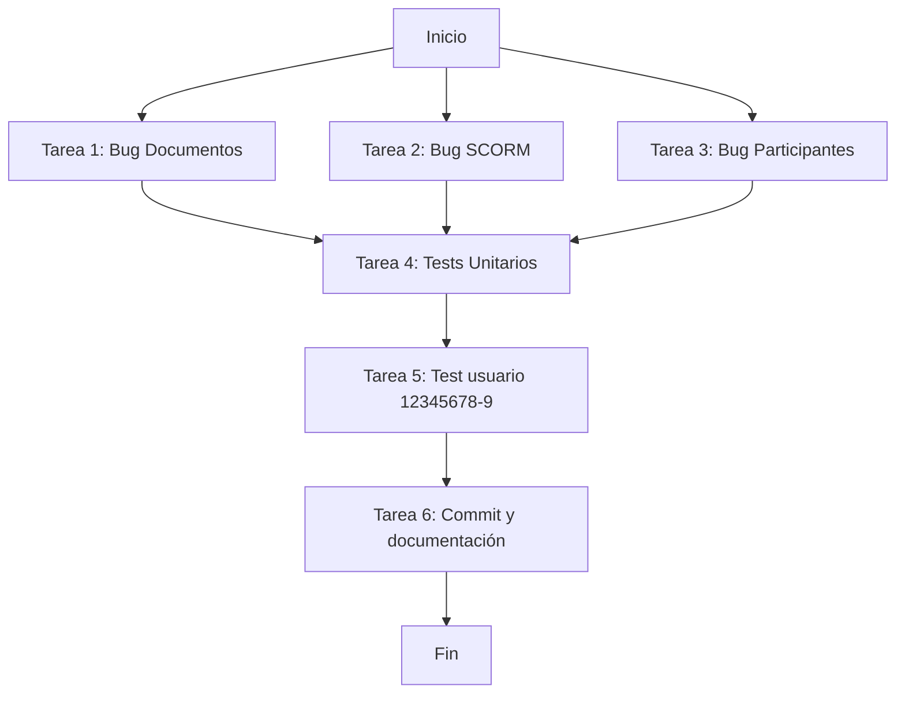
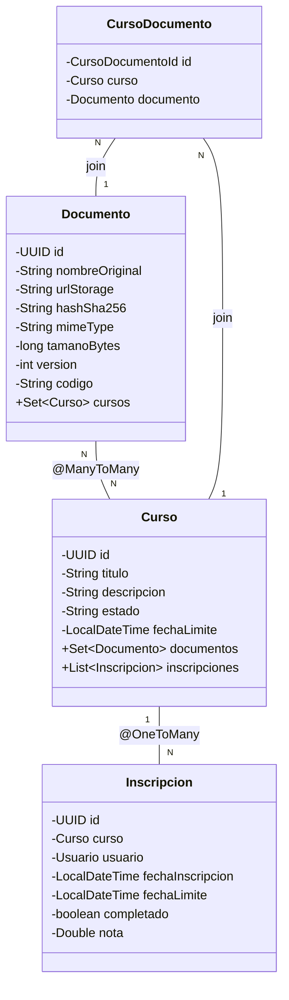

# Plan de Mejoras LMS - Corrección de Bugs y Tests

## Resumen de Bugs Detectados

### Bug 1: ⚠️ Error al cargar documentos vinculados
**Causa raíz:** [`Documento.java`](src/main/java/com/lms/model/Documento.java:60-61) tiene una relación `@ManyToMany(mappedBy = "documentos") private Set<Curso> cursos` que NO tiene `@JsonIgnore`. Esto crea una referencia circular al serializar: `Documento → cursos → Curso.documentos → Documento → ...`. Jackson lanza `StackOverflowError` o `JsonMappingException`, resultando en un error interno del servidor que no puede parsearse como JSON.

**Fallo visible:** La función [`cargarDocumentos()`](src/main/resources/templates/cursos/documentos.html:265-266) en `documentos.html` recibe status 200 pero JSON.parse falla, mostrando el mensaje de error.

### Bug 2: SCORM - "La página localhost ha rechazado la conexión"
**Causa raíz:** La plantilla [`scorm-player.html`](src/main/resources/templates/cursos/scorm-player.html) **NO EXISTE**. El controlador [`HomeController.java`](src/main/java/com/lms/controller/HomeController.java:180-188) intenta retornar la vista `"cursos/scorm-player"`, pero Thymeleaf no encuentra el archivo, causando `TemplateNotFoundException`.

Además, [`ScormController.java`](src/main/java/com/lms/controller/ScormController.java:34) está anotado como `@RestController` pero tiene el método [`reproducirPaqueteScorm()`](src/main/java/com/lms/controller/ScormController.java:142-152) que retorna un nombre de vista. Aunque el frontend apunta a la ruta correcta en HomeController, la inconsistencia debe corregirse.

**Fallo visible:** Al hacer clic en "Reproducir SCORM" → `GET /cursos/scorm/{paqueteId}/play` → HomeController intenta renderizar `scorm-player.html` (no existe) → Error 500/404 en el navegador.

### Bug 3: Inscribir participante no persiste en el listado
**Causa raíz:** La función [`cargarInscritos()`](src/main/resources/templates/cursos/participantes.html:195-231) en `participantes.html` llama a `GET /api/v1/mis-cursos` (línea 199), que retorna los cursos del usuario **AUTENTICADO** actual, NO los participantes del curso que se está visualizando. Si un ADMIN inscribe a un usuario, al consultar `/api/v1/mis-cursos` solo ve sus propias inscripciones, no las del curso.

**Fallo visible:** La inscripción se guarda en BD (la respuesta es 200/201), pero al recargar el listado, no aparecen los inscritos porque la consulta es incorrecta.

---

## Plan de Trabajo

### [X] Tarea 1: Corregir Bug 1 - Documentos Vinculados
**Archivos a modificar:**
- [`src/main/java/com/lms/model/Documento.java`](src/main/java/com/lms/model/Documento.java)

**Cambio:** Agregar `@JsonIgnore` en el campo `cursos` (línea 60-61) para romper la referencia circular durante la serialización JSON:
```java
@JsonIgnore
@ManyToMany(mappedBy = "documentos")
private Set<Curso> cursos = new HashSet<>();
```

### [X] Tarea 2: Corregir Bug 2 - Crear scorm-player.html
**Archivos a crear:**
- [`src/main/resources/templates/cursos/scorm-player.html`](src/main/resources/templates/cursos/scorm-player.html)

**Archivos a modificar:**
- [`src/main/java/com/lms/controller/ScormController.java`](src/main/java/com/lms/controller/ScormController.java:34) - Cambiar `@RestController` a `@Controller` o separar métodos REST de los de vista

**Template scorm-player.html:** Debe incluir:
- Layout base con sidebar
- Un iframe apuntando a `GET /api/v1/scorm/scorm/{paqueteId}/{indexFile}` para mostrar el contenido SCORM desde MinIO
- Parámetros SCORM runtime API (cmi.core, etc.) vía JavaScript embebido
- El `urlIndex` viene del modelo como `paquete.urlIndex`

### [X] Tarea 3: Corregir Bug 3 - Listado de participantes
**Archivos a modificar:**
1. [`src/main/java/com/lms/service/InscripcionService.java`](src/main/java/com/lms/service/InscripcionService.java) - Agregar método `listarParticipantesPorCurso(UUID cursoId)`
2. [`src/main/java/com/lms/controller/InscripcionController.java`](src/main/java/com/lms/controller/InscripcionController.java) - Agregar endpoint `GET /cursos/{cursoId}/participantes`
3. [`src/main/resources/templates/cursos/participantes.html`](src/main/resources/templates/cursos/participantes.html) - Actualizar `cargarInscritos()` para usar el nuevo endpoint

**Nuevo método en Service:**
```java
@Transactional(readOnly = true)
public List<InscripcionResponse> listarParticipantesPorCurso(UUID cursoId) {
    return inscripcionRepository.findByCursoIdAndDeletedAtIsNull(cursoId)
            .stream()
            .map(InscripcionResponse::fromEntity)
            .collect(Collectors.toList());
}
```

**Nuevo endpoint en Controller:**
```java
@GetMapping("/cursos/{cursoId}/participantes")
public ResponseEntity<List<InscripcionResponse>> listarParticipantes(@PathVariable UUID cursoId) {
    return ResponseEntity.ok(inscripcionService.listarParticipantesPorCurso(cursoId));
}
```

**Cambio en participantes.html:** Reemplazar línea 199:
```javascript
// ANTES (INCORRECTO):
xhr.open('GET', '/api/v1/mis-cursos', true);

// DESPUÉS (CORRECTO):
xhr.open('GET', '/api/v1/cursos/' + cursoId + '/participantes', true);
```
Y eliminar el filtro manual `var filtrados = inscripciones.filter(...)` (línea 203).

### [X] Tarea 4: Crear test unitarios de integración
**Ubicación:** [`src/test/java/com/lms/`](src/test/java/com/lms/)

**Tests a crear:**

1. **DocumentoControllerTest** - Test de subida y listado de documentos por curso
2. **ScormControllerTest** - Test de subida SCORM y reproducción
3. **InscripcionControllerTest** - Test de inscripción individual y listado de participantes
4. **InscripcionServiceTest** - Test del nuevo método `listarParticipantesPorCurso`

Cada test debe verificar:
- HTTP status codes correctos
- Respuesta JSON válida
- Persistencia correcta en BD (con @DataJpaTest o @SpringBootTest)
- Autenticación (simular usuario logueado)

### [X] Tarea 5: Crear usuario test 12345678-9 y flujo completo
**Pasos:**
1. Crear usuario con RUT 12345678-9 vía API de registro o directamente en BD
2. Crear un curso de prueba
3. Asignar (inscribir) al usuario 12345678-9 al curso
4. Subir un documento y vincularlo al curso
5. Subir un paquete SCORM y vincularlo al curso
6. Loguearse como usuario 12345678-9
7. Verificar que puede ver el curso en "Mis Cursos"
8. Verificar que puede ver los documentos vinculados
9. Verificar que puede ver y reproducir el SCORM
10. Verificar que puede ejecutar la evaluación

### [X] Tarea 6: Documentar y hacer commit
- Commits con mensajes descriptivos en español
- Actualizar [`mejorasLMS.md`](plans/mejorasLMS.md) marcando tareas completadas con [X]

---

## Flujo de Trabajo Recomendado



## Diagrama de Arquitectura (Modelos Afectados)


