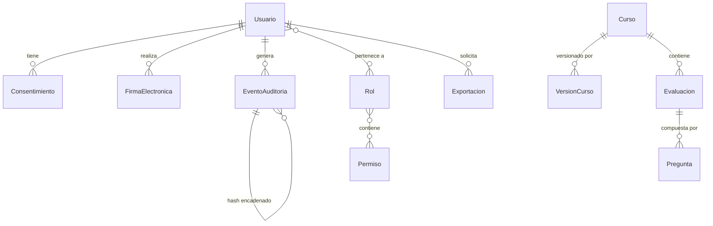

# Aclaraciones Arquitectónicas - LMS Core

**Fecha**: 2026-07-04
**Base**: Especificación Maestra LMS.md + Spec 001-lms-core

---

## Decisiones Arquitectónicas (ADRs)

### ADR-001: Framework Backend → Spring Boot 3.3

**Contexto**: Necesitamos un framework Java moderno, robusto, con seguridad integrada, ecosistema maduro y soporte empresarial.

**Decisión**: Spring Boot 3.3.

**Justificación**:
- Ecosistema maduro con Spring Security, Spring Data JPA, Spring MVC integrados.
- Inyección de dependencias nativa (IoC Container).
- Documentación OpenAPI/Swagger vía springdoc-openapi.
- Soporte de Jakarta Validation para validación de DTOs.
- Amplia adopción empresarial y comunidad activa.
- Facilidad de despliegue (JAR embebido con Tomcat).

**Consecuencias**:
- La lógica de negocio se organiza en capas (Controller → Service → Repository).
- Las dependencias se manejan con inyección de dependencias de Spring (@Autowired / constructor injection).

---

### ADR-002: ORM → Spring Data JPA + Hibernate + Flyway

**Contexto**: Necesitamos un ORM maduro con soporte de migraciones, UUID, tipos PostgreSQL.

**Decisión**: Spring Data JPA / Hibernate 6.4+ + Flyway 10+.

**Justificación**:
- Spring Data JPA proporciona repositorios automáticos (JpaRepository<T, ID>).
- Hibernate soporta UUID como Primary Key, herencia, y tipos PostgreSQL.
- Flyway permite migraciones SQL versionadas y reversibles (rollback).
- Integración nativa con Spring Boot (auto-configuración).
- Madurez probada en entornos empresariales.

**Consecuencias**:
- Las entidades JPA se mapean con anotaciones Jakarta Persistence (@Entity, @Table, etc.).
- Todas las migraciones serán archivos SQL versionados en `src/main/resources/db/migration/`.

---

### ADR-003: Autenticación → JWT (JJWT) + Spring Security

**Contexto**: Necesitamos autenticación stateless, segura y con soporte de MFA.

**Decisión**: JWT (access + refresh tokens) con Spring Security filter chain.

**Justificación**:
- Stateless: no requiere sesión en BD (escalable horizontalmente).
- JJWT (Java JWT) es la librería líder para creación/verificación de JWT en Java.
- Spring Security proporciona el filter chain para proteger endpoints por rol/permiso.
- Refresh tokens permiten renovar sesión sin reautenticar.
- Fácil integración con MFA (TOTP).

**Consecuencias**:
- Access token: corta duración (15 min).
- Refresh token: larga duración (7 días), almacenado en BD para revocación.
- MFA (TOTP) requerido para administradores.
- `JwtAuthenticationFilter` extiende `OncePerRequestFilter` para validar JWT en cada request.

---

### ADR-004: Object Storage → MinIO (S3-compatible)

**Contexto**: Almacenamiento de archivos físicos fuera de la BD.

**Decisión**: MinIO como Object Storage local con API compatible S3.

**Justificación**:
- BD solo almacena metadatos (id, url, hash, mime, versión).
- MinIO es compatible con SDK S3 de AWS (AWS SDK Java v2).
- Fácil migración a S3 en producción.
- Open Source, Docker-ready.

**Consecuencias**:
- Los archivos se suben directamente a MinIO via presigned URLs.
- La BD registra solo la referencia y el hash SHA-256.
- Se usa `MinioService` (Spring @Service) como wrapper del SDK.

---

### ADR-005: Event Sourcing → Tabla única de eventos de auditoría

**Contexto**: Trazabilidad total e inmutabilidad requerida por LMS.md.

**Decisión**: Tabla `evento_auditoria` con solo INSERT (prohibido UPDATE/DELETE).

**Justificación**:
- Un solo punto de registro para todos los eventos críticos.
- Hash encadenado: cada evento contiene hash del evento anterior.
- UUID como PK, timestamp, tipo de evento, actor, metadata (IP, User-Agent).
- La integridad se verifica recorriendo la cadena de hashes.

**Consecuencias**:
- Los logs de auditoría son inmutables por diseño.
- Verificación periódica de integridad de la cadena.

---

### ADR-006: Soft Delete → Mixin base para todas las entidades

**Contexto**: Política "No Borrar" del sistema.

**Decisión**: Mixin `SoftDeleteMixin` con campos `deleted_at`, `deleted_by`, `reason`.

**Justificación**:
- Consistencia: todas las entidades implementan el mismo patrón.
- Filtro global en queries para excluir registros eliminados.
- Trazabilidad de quién y por qué eliminó un registro.

**Consecuencias**:
- Toda query debe aplicar filtro `deleted_at.is_(None)`.
- Las eliminaciones registran evento de auditoría.

---

### ADR-007: Background Tasks → Spring `@Async` + TaskExecutor

**Contexto**: Exportaciones XLSX y procesos pesados no deben bloquear la API.

**Decisión**: Spring `@Async` + ThreadPoolTaskExecutor.

**Justificación**:
- Integración nativa con Spring Boot sin dependencias externas.
- ThreadPoolTaskExecutor permite configurar pool de hilos.
- Redis como caché (no como cola de mensajes) para reducir complejidad.
- Escalable horizontalmente con múltiples instancias del backend.

**Consecuencias**:
- API retorna `taskId` (UUID) inmediatamente.
- Frontend polling hasta que la tarea se complete.
- Archivos generados se almacenan en MinIO.
- Se usa `CompletableFuture` para manejo de resultados asíncronos.

---

### ADR-008: Pruebas en src/test/java (Convención Maven)

**Contexto**: Organización obligatoria de pruebas.

**Decisión**: Todos los archivos de pruebas deben estar en `src/test/java/com/lms/`.

**Justificación**:
- Convención estándar de Maven para proyectos Java.
- Separación clara entre código de producción (`src/main/java`) y pruebas (`src/test/java`).
- Facilita configuración de CI/CD (Maven surefire plugin escanea `src/test/java` por defecto).
- Evita mezclar código de prueba con código de producción.

**Consecuencias**:
- Tests unitarios en `src/test/java/com/lms/service/`, `src/test/java/com/lms/util/`.
- Tests de integración en `src/test/java/com/lms/controller/`, `src/test/java/com/lms/repository/`.
- Tests de contrato en `src/test/java/com/lms/controller/`.

---

### ADR-009: Versionado de Cursos → Tabla separada de versiones

**Contexto**: LMS.md exige historial completo de versiones con hashes.

**Decisión**: Tabla `version_curso` con copia del contenido, hash, y referencia a versión anterior.

**Justificación**:
- Cada versión es un registro independiente (inmutable).
- Hash SHA-256 de contenido + hash de versión anterior = cadena de integridad.
- La entidad `curso` solo mantiene la versión activa (pointer).
- Consultar historial = SELECT en `version_curso` ordenado por versión.

**Consecuencias**:
- Cada actualización de curso crea un nuevo INSERT en `version_curso`.
- La entidad `curso` tiene campo `version_actual_id` apuntando a la última versión.

---

### ADR-010: Hash Encadenado (Chain Hashing)

**Contexto**: LMS.md exige "Hash encadenado, logs inmutables" para no repudio.

**Decisión**: Cada evento de auditoría incluye `hash_anterior` (SHA-256 del evento previo).

**Justificación**:
- Si un evento es alterado, el hash de todos los eventos siguientes cambia.
- Detección inmediata de manipulación.
- Verificación periódica automatizada.

**Consecuencias**:
- Cálculo O(1) para nuevo evento (solo necesita último hash).
- Verificación O(n) para toda la cadena.

---

### ADR-011: Integración SCORM (1.2 / 2004)

**Contexto**: LMS.md exige soporte para contenido SCORM 1.2 y SCORM 2004, incluyendo subida de paquetes ZIP, runtime API de comunicación y reproductor embebido.

**Decisión**: Almacenamiento de paquetes SCORM en MinIO + metadatos en PostgreSQL + Runtime API REST + reproductor vía iframe con inyección de API JavaScript.

**Justificación**:
- Los paquetes SCORM son archivos ZIP con estructura específica (imsmanifest.xml). Se almacenan completos en MinIO y se extrae el `indexFile` para reproducción.
- La tabla `paquetes_scorm` almacena metadatos (título, versión SCORM, tamaño, URL del ZIP, URL del index).
- La tabla `scorm_datos_alumno` almacena el modelo de datos CMI (Core Model Interface) con clave/valor por alumno, paquete e intento.
- La Runtime API se implementa vía endpoints REST (Initialize, GetValue, SetValue, Commit, Finish) con sesiones en memoria (ConcurrentHashMap).
- La comunicación LMS ↔ Paquete SCORM se realiza mediante inyección de `scorm-api.js` en el iframe del reproductor.
- Se soportan ambas versiones: SCORM 1.2 (RTE1) y SCORM 2004 (RTE2) con detección automática desde imsmanifest.xml.

**Consecuencias**:
- Los paquetes SCORM se almacenan completos en MinIO (no se extraen archivos individuales).
- Cada sesión de reproducción genera un intento (UUID) que agrupa todos los datos del alumno.
- El reproductor usa iframe con inyección de API JS (requiere mismo origen o CORS configurado).
- La verificación de integridad se realiza vía hash SHA-256 del ZIP completo.

---

### ADR-012: Editor WYSIWYG → Quill.js

**Contexto**: Los cursos y evaluaciones requieren edición de contenido enriquecido (texto formateado, imágenes, videos embebidos, listas, tablas).

**Decisión**: Quill.js v1.3.7 como editor WYSIWYG vanilla JavaScript, sin dependencias de frameworks.

**Justificación**:
- Quill.js es liviano (~43KB gzip), modular y fácil de integrar sin React/Vue/Angular.
- Soporta handlers personalizados para subida de imágenes y embebido de videos.
- La configuración centralizada en `config.js` permite definir toolbar, handlers de imagen/video y atajos de teclado.
- Los estilos se personalizan via `quill-custom.css` para mantener consistencia visual con el tema del LMS.
- Quill.js genera HTML limpio que se almacena directamente en la BD como contenido del curso/evaluación.
- No requiere backend adicional: las imágenes se suben al servidor via handler personalizado.

**Consecuencias**:
- El contenido editado se almacena como HTML en la columna `contenido` de la entidad correspondiente.
- Las imágenes subidas se almacenan en el servidor (no en MinIO directamente).
- Los videos se embeben via URL (YouTube, Vimeo) usando el handler `videoHandler`.
- Se debe mantener la versión de Quill.js congelada (v1.3.7) para evitar breaking changes.

---

## Stack Tecnológico Final

| Componente | Elección | Versión |
|-----------|---------|---------|
| Backend | Spring Boot | 3.3 |
| ORM | Spring Data JPA / Hibernate | 6.4+ |
| BD | PostgreSQL | 16+ |
| Migraciones | Flyway | 10+ |
| Cache | Redis | 7+ |
| Task Queue | Spring `@Async` / TaskExecutor | - |
| Object Storage | MinIO | Latest |
| Auth | JWT (JJWT) + Spring Security | 0.12+ / 6.3 |
| Testing | JUnit 5 + Mockito | 5.10+ / 5+ |
| Validación | Jakarta Validation | 3.0+ |
| Generación XLSX | Apache POI | 5.2+ |
| Frontend | Thymeleaf + HTMX | 3.1+ / 2+ |
| Editor WYSIWYG | Quill.js | 1.3.7 |
| SCORM Runtime | API REST propia (init/get/set/commit/finish) | 1.2 / 2004 |
| Observabilidad | OpenTelemetry + Micrometer | Latest |
| Contenedores | Docker Compose | Latest |
| Build | Maven | 3.9+ |
| Lenguaje | Java | 17+ |

---

## Modelo de Datos (Conceptual)



---

## Flujo de Consentimiento Informado

```
[Usuario] → Registro → [API] → Crear Usuario (UUID) 
    → Redirigir a consentimiento → [API] 
    → Mostrar documento legal + versión política 
    → Usuario acepta/rechaza 
    → [API] → INSERT evento_auditoria (tipo=CONSENTIMIENTO, 
      IP, User-Agent, Hash documento, versión, timestamp)
    → Si acepta: acceso concedido. Si rechaza: acceso denegado.
```

---

## Flujo de Firma Electrónica

```
[Usuario autenticado] → Solicita firma → [API] 
    → Verifica sesión + MFA (si admin) 
    → Muestra documento a firmar 
    → Usuario confirma → [API] 
    → INSERT evento_auditoria (tipo=FIRMA, 
      IP, timestamp, User-Agent, geo, hash_documento, hash_anterior)
    → Hash encadenado verificado → Firma completada
```

---

## Estructura de Archivos Final

```text
/
├── specs/001-lms-core/
│   ├── spec.md
│   ├── clarificaciones.md     # ← Este archivo
│   ├── plan.md
│   ├── data-model.md
│   └── tasks.md
├── src/
│   ├── api/
│   ├── core/
│   ├── models/
│   ├── schemas/
│   ├── services/
│   ├── tasks/
│   └── utils/
├── tests/
│   ├── unit/
│   ├── integration/
│   └── contract/
├── migrations/
├── docs/
├── config/
├── scripts/
├── docker/
└── requirements/
```
