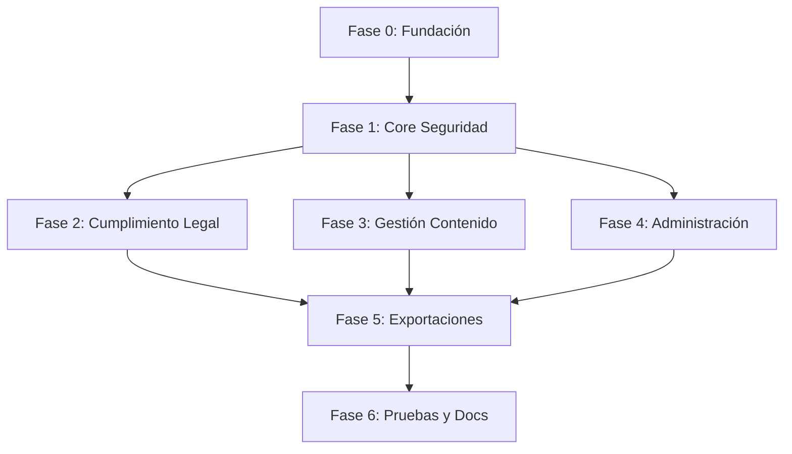

# Plan de Implementación: LMS Core

**Branch**: `001-lms-core` | **Fecha**: 2026-07-04 | **Spec**: [`spec.md`](specs/001-lms-core/spec.md)

---

## Resumen

Implementación de la estructura base del LMS LegalTech: modelos, API REST, Event Sourcing, autenticación JWT+Spring Security, Soft Delete, Hash SHA-256 encadenado, consentimiento informado, firma electrónica, RBAC granular, versionado de cursos, Object Storage (MinIO) y exportaciones asíncronas (Spring `@Async`). Stack: Spring Boot 3.3 + PostgreSQL + JPA/Hibernate + Flyway + MinIO + Spring Security + JJWT.

---

## Contexto Técnico

| Atributo | Valor |
|----------|-------|
| **Lenguaje/Versión** | Java 17+ |
| **Framework** | Spring Boot 3.3 |
| **ORM** | Spring Data JPA / Hibernate 6.4+ |
| **Base de Datos** | PostgreSQL 16+ |
| **Migraciones** | Flyway 10+ |
| **Cache** | Redis 7+ |
| **Task Queue** | Spring `@Async` / TaskExecutor |
| **Object Storage** | MinIO (S3-compatible, AWS SDK Java) |
| **Autenticación** | JWT (JJWT 0.12+) + Spring Security 6.3 |
| **Testing** | JUnit 5.10+ + Mockito 5+ + Spring Boot Test |
| **Validación** | Jakarta Validation 3.0+ (Hibernate Validator) |
| **Observabilidad** | OpenTelemetry SDK + Micrometer |
| **Contenedores** | Docker + Docker Compose |
| **Plataforma Objetivo** | Linux server (producción), Windows (desarrollo) |
| **Tipo de Proyecto** | Web service (API REST + MVC) |
| **Generación XLSX** | Apache POI 5.2+ |
| **Frontend** | Thymeleaf 3.1+ + HTMX 2+ |
| **Metas de Rendimiento** | 1000 req/s, <200ms p95 |
| **Escala** | 10K+ usuarios, 100+ cursos |

---

## Verificación Constitucional

| Regla | Estado | Justificación |
|-------|--------|---------------|
| UUIDs como PK | ✅ Cumple | Todas las entidades usan UUID |
| Soft Delete | ✅ Cumple | Mixin con deleted_at, deleted_by, reason |
| Hash SHA-256 | ✅ Cumple | Implementado en modelos y archivos |
| Event Sourcing | ✅ Cumple | Solo INSERT, hash encadenado |
| No RUT como PK | ✅ Cumple | Nunca se usa RUT como clave |
| API-First | ✅ Cumple | Toda la lógica via API REST |
| Código en español | ✅ Cumple | 100% español |
| Pruebas en /tests | ✅ Cumple | Todo en /tests/ |
| AES-256 + TLS 1.3 | ✅ Cumple | En reposo y tránsito |
| MFA para admins | ✅ Cumple | TOTP en login admin |
| RBAC granular | ✅ Cumple | Permisos por recurso+acción |
| Consentimiento informado | ✅ Cumple | Flujo obligatorio primer login |

---

## Estructura del Proyecto

```text
/
├── specs/001-lms-core/
│   ├── spec.md              # Especificación funcional
│   ├── clarificaciones.md   # Decisiones arquitectónicas
│   ├── plan.md              # ← Este archivo
│   ├── data-model.md        # Modelo de datos detallado
│   └── tasks.md             # Tareas de implementación
├── src/
│   ├── main/java/com/lms/
│   │   ├── LMSApplication.java         # @SpringBootApplication
│   │   ├── config/
│   │   │   ├── AppConfig.java
│   │   │   ├── SecurityConfig.java
│   │   │   ├── OpenTelemetryConfig.java
│   │   │   └── AsyncConfig.java
│   │   ├── controller/
│   │   │   ├── AuthController.java
│   │   │   ├── UsuarioController.java
│   │   │   ├── CursoController.java
│   │   │   ├── EvaluacionController.java
│   │   │   ├── DocumentoController.java
│   │   │   ├── FirmaController.java
│   │   │   ├── AuditoriaController.java
│   │   │   ├── RolController.java
│   │   │   └── ExportacionController.java
│   │   ├── model/
│   │   │   ├── BaseEntity.java
│   │   │   ├── Usuario.java
│   │   │   ├── Consentimiento.java
│   │   │   ├── FirmaElectronica.java
│   │   │   ├── Curso.java
│   │   │   ├── VersionCurso.java
│   │   │   ├── Evaluacion.java
│   │   │   ├── Pregunta.java
│   │   │   ├── Documento.java
│   │   │   ├── EventoAuditoria.java
│   │   │   ├── Rol.java
│   │   │   ├── Permiso.java
│   │   │   └── Exportacion.java
│   │   ├── repository/
│   │   │   ├── UsuarioRepository.java
│   │   │   ├── ConsentimientoRepository.java
│   │   │   ├── FirmaElectronicaRepository.java
│   │   │   ├── CursoRepository.java
│   │   │   ├── VersionCursoRepository.java
│   │   │   ├── EvaluacionRepository.java
│   │   │   ├── PreguntaRepository.java
│   │   │   ├── DocumentoRepository.java
│   │   │   ├── EventoAuditoriaRepository.java
│   │   │   ├── RolRepository.java
│   │   │   ├── PermisoRepository.java
│   │   │   └── ExportacionRepository.java
│   │   ├── service/
│   │   │   ├── AuthService.java
│   │   │   ├── UsuarioService.java
│   │   │   ├── ConsentimientoService.java
│   │   │   ├── FirmaService.java
│   │   │   ├── CursoService.java
│   │   │   ├── EvaluacionService.java
│   │   │   ├── DocumentoService.java
│   │   │   ├── AuditoriaService.java
│   │   │   ├── RolService.java
│   │   │   ├── ExportacionService.java
│   │   │   └── MinioService.java
│   │   ├── security/
│   │   │   ├── JwtAuthenticationFilter.java
│   │   │   ├── JwtTokenProvider.java
│   │   │   ├── UserPrincipal.java
│   │   │   └── DatabaseUserDetailsService.java
│   │   └── util/
│   │       ├── HashUtils.java
│   │       ├── EncryptionUtils.java
│   │       ├── AuditLogger.java
│   │       └── GeoIpUtils.java
│   └── resources/
│       ├── application.yml
│       ├── application-dev.yml
│       ├── application-prod.yml
│       ├── db/migration/
│       │   ├── V1__initial_schema.sql
│       │   ├── V2__seed_roles_permisos.sql
│       │   └── V3__fix_indexes_metadata.sql
│       ├── static/
│       │   ├── css/
│       │   └── js/
│       └── templates/
│           ├── index.html
│           ├── auth/
│           ├── dashboard/
│           ├── admin/
│           └── fragments/
└── src/test/java/com/lms/
    ├── LMSApplicationTests.java
    ├── config/
    │   ├── TestConfig.java
    │   └── TestSecurityConfig.java
    ├── controller/
    │   ├── AuthControllerTest.java
    │   ├── CursoControllerTest.java
    │   ├── FirmaControllerTest.java
    │   └── HomeControllerTest.java
    ├── service/
    │   ├── UsuarioServiceTest.java
    │   ├── ConsentimientoServiceTest.java
    │   ├── FirmaServiceTest.java
    │   ├── CursoServiceTest.java
    │   ├── ExportacionServiceTest.java
    │   └── HashUtilsTest.java
    └── repository/
        └── UsuarioRepositoryTest.java
├── docs/
│   ├── arquitectura.md
│   └── api.md
├── scripts/
│   ├── init-db.sh
│   └── seed-data.sql
├── docker/
│   ├── Dockerfile
│   ├── Dockerfile.java
│   └── docker-compose.yml
├── pom.xml
└── README.md
```

**Decisión de Estructura**: Proyecto único Maven (monorepo backend) con separación clara en capas (Controller → Service → Repository). Frontend Thymeleaf+HTMX integrado en el mismo proyecto (server-side rendering). Pruebas obligatoriamente en `src/test/java/com/lms/`.

---

## Fases de Implementación

### Fase 0: Fundación (Setup)
- Inicialización del proyecto Maven (pom.xml)
- Configuración de Docker (PostgreSQL, Redis, MinIO)
- Configuración de Flyway (migración inicial)
- Base entity (UUID, Timestamp, SoftDelete @MappedSuperclass)
- Configuración Spring Boot (application.yml, @ConfigurationProperties)

### Fase 1: Core Seguridad (Bloqueante)
- Modelo Usuario, Rol, Permiso
- Servicio de autenticación (JWT con JJWT, Spring Security, MFA TOTP)
- Hashing SHA-256, AES-256
- Soft Delete implementado con @Where(filter) / consultas
- Hash encadenado para Event Sourcing

### Fase 2: Cumplimiento Legal (P1)
- Modelo Consentimiento + flujo completo
- Modelo FirmaElectronica + flujo completo
- EventoAuditoria con hash encadenado
- Endpoints de consentimiento y firma

### Fase 3: Gestión Contenido (P1)
- Modelos Curso, VersionCurso
- Modelos Evaluacion, Pregunta
- Servicio de Object Storage (MinIO)
- Endpoints CRUD con versionado

### Fase 4: Administración (P2)
- CRUD Roles y permisos granulares
- Endpoints de auditoría
- Impersonación controlada
- MFA obligatorio para admins

### Fase 5: Exportaciones y Dashboards (P2)
- Spring `@Async` + TaskExecutor configurados
- Tarea de exportación XLSX (Apache POI)
- Endpoints de dashboard (KPIs)
- OpenTelemetry + Micrometer integrados

### Fase 6: Pruebas y Documentación
- Tests unitarios (JUnit 5 + Mockito, capa servicios)
- Tests de integración (Spring Boot Test, @WebMvcTest, @DataJpaTest)
- Tests de contrato (API)
- Documentación de arquitectura y API

---

## Dependencias entre Fases



---

## Riesgos y Mitigaciones

| Riesgo | Impacto | Mitigación |
|--------|---------|------------|
| Complejidad de Event Sourcing | Alto | Empezar con tabla simple de auditoría, escalar después |
| Rendimiento de hash encadenado | Medio | Verificación periódica, no en cada request |
| MinIO no disponible | Alto | Circuit breaker + retry con backoff exponencial |
| Concurrencia en versionado | Medio | Optimistic Locking con número de versión |
| MFA bloquea desarrollo | Bajo | Configurable por feature flag en desarrollo |
