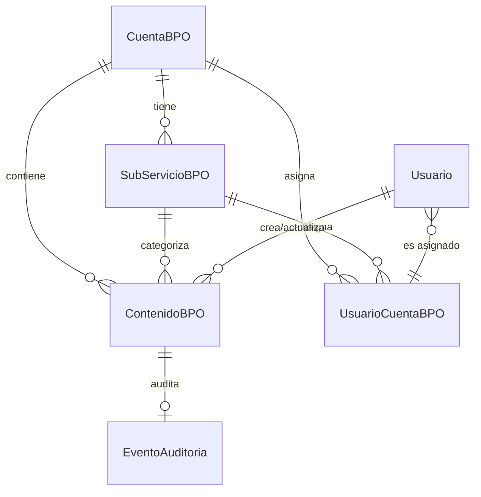

# Modelo de Datos: Gestor de Contenidos BPO

**Versión**: 1.0
**Fecha**: 2026-07-24

## Entidades

### ContenidoBPO

Entidad principal del módulo. Representa cualquier tipo de contenido (procedimiento, noticia, oferta, etc.).

| Campo | Tipo | Restricciones | Descripción |
|-------|------|---------------|-------------|
| id | UUID | PK, autogenerado | Identificador único |
| tipo | VARCHAR(50) | NOT NULL | Tipo de contenido: `procedimiento`, `noticia`, `oferta` |
| titulo | VARCHAR(255) | NOT NULL | Título del contenido |
| descripcion_corta | TEXT | | Resumen o extracto |
| contenido_html | TEXT | NOT NULL | Cuerpo del contenido en HTML (texto enriquecido) |
| metadatos | JSONB | DEFAULT '{}' | Metadatos flexibles específicos por tipo |
| etiquetas | JSONB | DEFAULT '[]' | Array de etiquetas para búsqueda y filtrado |
| estado | VARCHAR(20) | NOT NULL DEFAULT 'borrador' | `borrador`, `publicado`, `archivado` |
| vigencia_desde | TIMESTAMP | | Inicio de vigencia (requerido si estado=publicado) |
| vigencia_hasta | TIMESTAMP | | Fin de vigencia (requerido si estado=publicado) |
| cuenta_id | UUID | FK → CuentaBPO.id, NOT NULL | Cuenta a la que pertenece |
| subservicio_id | UUID | FK → SubServicioBPO.id, nullable | Subservicio asociado (opcional) |
| creado_por | UUID | FK → Usuario.id, NOT NULL | Usuario que creó el contenido |
| actualizado_por | UUID | FK → Usuario.id | Último usuario que modificó |
| created_at | TIMESTAMP | NOT NULL, DEFAULT NOW() | Fecha de creación |
| updated_at | TIMESTAMP | | Fecha de última modificación |
| deleted_at | TIMESTAMP | | Fecha de borrado suave |
| deleted_by | UUID | FK → Usuario.id | Usuario que eliminó |
| reason | VARCHAR(500) | | Motivo de eliminación |

**Índices**:
- `idx_contenido_cuenta` ON cuenta_id
- `idx_contenido_estado` ON estado
- `idx_contenido_tipo` ON tipo
- `idx_contenido_vigencia` ON (vigencia_desde, vigencia_hasta)
- `idx_contenido_busqueda` GIN ON to_tsvector('spanish', titulo || ' ' || descripcion_corta)
- `idx_contenido_metadatos` GIN ON metadatos

**Restricciones**:
- CHECK (estado IN ('borrador', 'publicado', 'archivado'))
- CHECK (tipo IN ('procedimiento', 'noticia', 'oferta'))
- CHECK (estado = 'publicado' → vigencia_desde IS NOT NULL AND vigencia_hasta IS NOT NULL)

---

### CuentaBPO

Representa un cliente o empresa (Cliente A, Cliente B, etc.).

| Campo | Tipo | Restricciones | Descripción |
|-------|------|---------------|-------------|
| id | UUID | PK, autogenerado | Identificador único |
| nombre | VARCHAR(150) | NOT NULL, UNIQUE | Nombre comercial de la cuenta |
| codigo | VARCHAR(50) | NOT NULL, UNIQUE | Código interno para integraciones |
| activa | BOOLEAN | NOT NULL DEFAULT TRUE | Si la cuenta está operativa |
| created_at | TIMESTAMP | NOT NULL, DEFAULT NOW() | Fecha de creación |
| updated_at | TIMESTAMP | | Fecha de última modificación |
| deleted_at | TIMESTAMP | | Fecha de borrado suave |

---

### SubServicioBPO

Subdivisión de una cuenta (Ej: Cliente A Hogar, Cliente A Empresa).

| Campo | Tipo | Restricciones | Descripción |
|-------|------|---------------|-------------|
| id | UUID | PK, autogenerado | Identificador único |
| nombre | VARCHAR(150) | NOT NULL | Nombre del subservicio |
| cuenta_id | UUID | FK → CuentaBPO.id, NOT NULL | Cuenta padre |
| activo | BOOLEAN | NOT NULL DEFAULT TRUE | Si el subservicio está operativo |
| created_at | TIMESTAMP | NOT NULL, DEFAULT NOW() | Fecha de creación |
| updated_at | TIMESTAMP | | Fecha de última modificación |
| deleted_at | TIMESTAMP | | Fecha de borrado suave |

**Restricción**: UNIQUE (nombre, cuenta_id)

---

### UsuarioCuentaBPO

Tabla puente que asigna a un usuario BPO una o más cuentas y opcionalmente subservicios.

| Campo | Tipo | Restricciones | Descripción |
|-------|------|---------------|-------------|
| usuario_id | UUID | FK → Usuario.id, NOT NULL | Usuario BPO |
| cuenta_id | UUID | FK → CuentaBPO.id, NOT NULL | Cuenta asignada |
| subservicio_id | UUID | FK → SubServicioBPO.id, nullable | Subservicio específico (opcional) |
| created_at | TIMESTAMP | NOT NULL, DEFAULT NOW() | Fecha de asignación |
| created_by | UUID | FK → Usuario.id, NOT NULL | Quién realizó la asignación |

**PK Compuesta**: (usuario_id, cuenta_id, subservicio_id)
**Restricción**: Si subservicio_id no es NULL, debe pertenecer a cuenta_id

---

## Relaciones



## Migración SQL (Flyway)

Archivo: `src/main/resources/db/migration/V20260724__crear_modulo_bpo.sql`

```sql
-- Tabla: cuentas_bpo
CREATE TABLE cuentas_bpo (
    id UUID PRIMARY KEY DEFAULT gen_random_uuid(),
    nombre VARCHAR(150) NOT NULL UNIQUE,
    codigo VARCHAR(50) NOT NULL UNIQUE,
    activa BOOLEAN NOT NULL DEFAULT TRUE,
    created_at TIMESTAMP NOT NULL DEFAULT NOW(),
    updated_at TIMESTAMP,
    deleted_at TIMESTAMP
);

-- Tabla: subservicios_bpo
CREATE TABLE subservicios_bpo (
    id UUID PRIMARY KEY DEFAULT gen_random_uuid(),
    nombre VARCHAR(150) NOT NULL,
    cuenta_id UUID NOT NULL REFERENCES cuentas_bpo(id),
    activo BOOLEAN NOT NULL DEFAULT TRUE,
    created_at TIMESTAMP NOT NULL DEFAULT NOW(),
    updated_at TIMESTAMP,
    deleted_at TIMESTAMP,
    UNIQUE (nombre, cuenta_id)
);

-- Tabla: contenidos_bpo
CREATE TABLE contenidos_bpo (
    id UUID PRIMARY KEY DEFAULT gen_random_uuid(),
    tipo VARCHAR(50) NOT NULL CHECK (tipo IN ('procedimiento', 'noticia', 'oferta')),
    titulo VARCHAR(255) NOT NULL,
    descripcion_corta TEXT,
    contenido_html TEXT NOT NULL,
    metadatos JSONB NOT NULL DEFAULT '{}',
    etiquetas JSONB NOT NULL DEFAULT '[]',
    estado VARCHAR(20) NOT NULL DEFAULT 'borrador'
        CHECK (estado IN ('borrador', 'publicado', 'archivado')),
    vigencia_desde TIMESTAMP,
    vigencia_hasta TIMESTAMP,
    cuenta_id UUID NOT NULL REFERENCES cuentas_bpo(id),
    subservicio_id UUID REFERENCES subservicios_bpo(id),
    creado_por UUID NOT NULL REFERENCES usuarios(id),
    actualizado_por UUID REFERENCES usuarios(id),
    created_at TIMESTAMP NOT NULL DEFAULT NOW(),
    updated_at TIMESTAMP,
    deleted_at TIMESTAMP,
    deleted_by UUID REFERENCES usuarios(id),
    reason VARCHAR(500),
    CONSTRAINT vigencia_requerida_publicado
        CHECK (estado != 'publicado' OR (vigencia_desde IS NOT NULL AND vigencia_hasta IS NOT NULL))
);

CREATE INDEX idx_contenido_cuenta ON contenidos_bpo(cuenta_id);
CREATE INDEX idx_contenido_estado ON contenidos_bpo(estado);
CREATE INDEX idx_contenido_tipo ON contenidos_bpo(tipo);
CREATE INDEX idx_contenido_vigencia ON contenidos_bpo(vigencia_desde, vigencia_hasta);
CREATE INDEX idx_contenido_busqueda
    ON contenidos_bpo USING GIN (to_tsvector('spanish', coalesce(titulo,'') || ' ' || coalesce(descripcion_corta,'')));
CREATE INDEX idx_contenido_metadatos ON contenidos_bpo USING GIN (metadatos);

-- Tabla: usuarios_cuenta_bpo (puente)
CREATE TABLE usuarios_cuenta_bpo (
    usuario_id UUID NOT NULL REFERENCES usuarios(id),
    cuenta_id UUID NOT NULL REFERENCES cuentas_bpo(id),
    subservicio_id UUID REFERENCES subservicios_bpo(id),
    created_at TIMESTAMP NOT NULL DEFAULT NOW(),
    created_by UUID NOT NULL REFERENCES usuarios(id),
    PRIMARY KEY (usuario_id, cuenta_id, COALESCE(subservicio_id, '00000000-0000-0000-0000-000000000000')),
    CONSTRAINT subservicio_pertenece_cuenta
        CHECK (subservicio_id IS NULL OR
               EXISTS (SELECT 1 FROM subservicios_bpo WHERE id = subservicio_id AND cuenta_id = cuenta_id))
);

-- Permisos BPO
INSERT INTO permisos (id, nombre, recurso, accion, descripcion) VALUES
    (gen_random_uuid(), 'BPO_CONTENIDO_LEER', 'bpo.contenido', 'LEER', 'Leer contenidos BPO'),
    (gen_random_uuid(), 'BPO_CONTENIDO_CREAR', 'bpo.contenido', 'CREAR', 'Crear contenidos BPO'),
    (gen_random_uuid(), 'BPO_CONTENIDO_ACTUALIZAR', 'bpo.contenido', 'ACTUALIZAR', 'Actualizar contenidos BPO'),
    (gen_random_uuid(), 'BPO_CONTENIDO_ELIMINAR', 'bpo.contenido', 'ELIMINAR', 'Eliminar contenidos BPO'),
    (gen_random_uuid(), 'BPO_CONTENIDO_IMPORTAR', 'bpo.contenido', 'IMPORTAR', 'Importar contenidos vía API');

-- Tipos de evento de auditoría BPO
-- Se registran en EventoAuditoria con tipoEvento = 'BPO_CONTENIDO_CREADO', etc.
```
